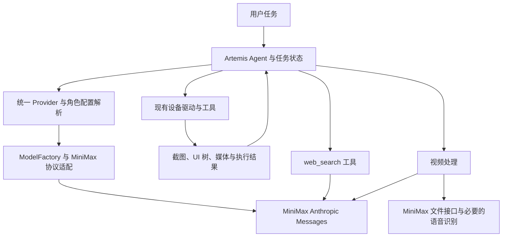
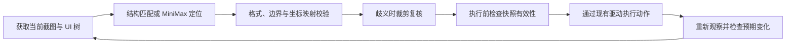

# Artemis 全 MiniMax 技术方案

- 日期：2026-11-01（Asia/Shanghai）。
- 版本：1.0，完整方案待评审；本文不表示功能已实现或精度已验证。
- 代码基线：`e7cbe5950fba16b7d31c852aa1e92309d7d6405c`，分支 `feat/model-config`。
- 适用范围：主 Agent 推理、视频分析、Explorer 屏幕探索、联网检索、OCR、目标坐标定位。
- 依据：本次会话已确认的需求、基线代码、MiniMax 官方文档及官方文档 MCP。

## 1. 目标、决策与范围

所有 AI 推理和识别由 MiniMax 提供，模型请求统一采用官方推荐的 Anthropic Messages 协议。本地保留 Artemis 的任务编排、设备驱动、ADB、截图、UI 树读取、图像裁剪、视频处理、坐标换算和执行结果检查。这些确定性程序不是另一套 AI 模型。

已由用户确定的方向：

1. 使用 MiniMax 完成六个模块的 AI 工作，不依赖 Google/Gemini API Key。
2. 使用 Anthropic 兼容接口；MiniMax 官方文档 MCP 用于开发查阅。
3. 不引入本地定位模型、第三方视觉模型或独立 OCR 模型。
4. 新的模型坐标协议采用 `[x,y]`，不沿用项目当前 `[y,x]` 输出再交换的约定。

本文提出的工程设计：复用现有 Provider 注册表、模型工厂、LangChain/LangGraph 编排与工具；默认候选为 `MiniMax-M3.1-Flash`；各角色通过提示词、思考深度、超时和媒体输入配置区分。模型可用性与实际定位、OCR 效果需要接入后验证，不能由文档能力声明推导为成功率保证。[S1][S2]

不在本轮范围内：实施代码、真实手机自动化测试、购买服务、部署本地模型、生成视频或替换 Android 设备层。视频模块处理的是视频理解，不是调用 Hailuo/H3 生成视频。

## 2. 当前代码与差距

以下均为基线现状，不是目标实现。

| 位置 | 已观察到的行为 | 目标改动 |
| --- | --- | --- |
| [providers.py](../../artemis/llm/providers.py) | 自定义 `kind` 只允许 OpenAI 兼容协议；默认 Provider 可替换需 Key 的内置厂商 | 增加 `anthropic` 协议，保留现有 OpenAI 条目与默认解析语义 |
| [router.py](../../artemis/llm/router.py) | 已有 `ChatAnthropic` 分支，但没有传入 `endpoint.api_base`；思考深度被映射为 `budget_tokens` | 正确传递 MiniMax 地址，按官方 `output_config.effort` 配置，保留其他厂商原有逻辑 |
| [services/llm.py](../../artemis/services/llm.py) | 主运行路径部分重复 Provider/模型解析；非 Google 模型移除 `google_search` | 统一调用 `resolve_model_config()`；增加真正可执行的 MiniMax 搜索工具 |
| [Explorer](../../artemis/agents/explorer/explorer.py)、[视频分析](../../artemis/agents/video_analyzer/video_analyzer.py) | 原生引擎选择依赖原始 Gemini 模型名、Google Key 或共享 Google Client | 根据已解析的实际 Provider 选择路径，MiniMax 路径不创建 Google Client |
| [目标检测](../../artemis/agents/object_detector/object_detector.py) | 模型按 `[y,x]` 输出，程序交换为 `[x,y]` | MiniMax 提示词、结构化结果与后续消费统一按 `[x,y]` |
| [目标检测模型获取](../../artemis/agents/object_detector/object_detector.py) | `get_llm(ctx, name="object_detector")` 未指定工具模型范围，异常后改用 Operator | 显式按 utility 范围获取已配置的目标检测模型；配置错误不得被宽泛异常捕获掩盖 |
| [ocr_api.py](../../artemis/utils/ocr_api.py) | 直接请求 Google Vision API，使用独立 OCR Key | 替换为 MiniMax 视觉识别；配置就绪条件来自 MiniMax |
| [SDK 预热](../../artemis/sdk/agent.py)、[记忆压缩](../../artemis/memory/chunking.py)、[轻量检查默认值](../../artemis/config/llm.py) | 仍存在 Google 专用初始化或硬编码模型 | 纳入同一 Provider 配置链，覆盖六模块之外的辅助推理入口 |
| [基础 LLM 配置](../../third_party/mobile_use/config/llm.py) | `reasoning_effort` 仅有 none/low/medium/high，fallback 必填 | 支持 MiniMax 所需档位并按厂商校验；迁移期处理必填 fallback，避免重复请求 |

锁文件基线已包含 `anthropic==0.122.0`、`langchain-anthropic==1.5.6`、`langchain-core==1.5.6`；这是代码锁定版本，不表示本地已安装或兼容性已验证。优先验证并复用这些依赖，避免另写通用 Agent 框架或复制 SDK。

## 3. 方案选择与架构

| 方案 | 取舍 | 决策 |
| --- | --- | --- |
| 保留 Chat Completions，再单独使用 Responses 搜索 | 现有代码改动较少，但消息、思考、搜索存在两套协议 | 不采用 |
| 统一 Anthropic Messages，复用现有编排与工具 | 与官方推荐一致，统一多模态与内容块处理；需要补齐适配 | 采用 |
| 直接重写全部 Agent 为原生 SDK 循环 | 控制自由，但会重复现有编排、可靠性和记录逻辑 | 不采用 |



职责边界：

- `resolve_model_config()` 是运行时与控制台共同的解析所有者，不在各 Agent 中重新解析 Key、模型或默认规则。
- `ModelFactory` 创建模型；MiniMax 专有的参数和内容块适配集中在该层下的薄适配器，不散落到六个模块。
- 各模块只准备任务输入、消费类型化结果，复用现有重试、取消、trace 和任务状态。
- LangChain 保留为编排接口。先验证锁定版本对 MiniMax thinking、视频和服务端工具块的保真；不满足时在薄适配器内使用官方 `anthropic.AsyncAnthropic`，而不是重写上层循环。
- 文档 MCP 是开发辅助工具，不加入 Artemis 的生产执行链，也不承担运行时联网搜索。

模型主入口为 `https://api.minimax.cn/anthropic`，SDK 请求路径为 `/v1/messages`，组合后的 HTTP 路径为 `/anthropic/v1/messages`。文件和语音接口使用 MiniMax 对应原生路径，不强行包装成 Messages；这些接口仍属于 MiniMax。[S1][S3][S4]

## 4. 配置、凭据与保存

### 4.1 凭据的唯一来源

沿用 `<用户应用目录>/llm_providers.json` 保存名为 `minimax` 的 Provider，新增允许 `kind="anthropic"`。厂商名称与传输协议分开：`name=minimax` 不代表购买 Anthropic 服务，实际请求发往配置的 MiniMax 地址。

Provider 存储字段继续使用既有格式：`name`、`kind`、`api_base`、`api_key`、`model`、`fallback_model`、`timeout_seconds`、`enabled` 等；不为了本次接入重命名历史字段。Windows 默认目录为 `%LOCALAPPDATA%\Artemis`，仍遵守 `ARTEMIS_APP_DIR` 覆盖规则。

- Key 只在用户目录保存，禁止写入项目配置、文档、测试夹具或 Git。
- 当前存储格式是明文 JSON；`SecretStr` 和响应掩码不构成磁盘加密。继续使用本机权限保护，检查 Windows ACL，临时文件也必须受保护。
- API 返回 `key_configured` 和掩码，不返回 Key；日志禁止记录授权头。
- 更新时 Key 留空表示保留已有值。首次创建缺 Key 则失败；清除 Key 使用明确操作，不能与“留空保留”混用。
- 保存采用进程间锁、唯一临时文件和原子替换，避免 CLI/API 并发读改写覆盖。写盘失败必须返回错误；持久化成功后才更新生效状态。
- 本方案使用注册表中的 Key，不依赖把 MiniMax Key 写成全局 `ANTHROPIC_API_KEY`，避免影响其他客户端。

### 4.2 角色配置

`artemis.jsonc` 继续保存角色与参数；以下是需要适配完成后的目标示例，不是当前即可使用的配置。

```jsonc
{
  "default": {
    "provider": "minimax",
    "model": "MiniMax-M3.1-Flash",
    "reasoning_effort": "medium",
    "fallback": {
      "provider": "minimax",
      "model": "MiniMax-M3.1-Flash",
      "reasoning_effort": "medium"
    }
  },
  "nodes": {
    "planner": { "reasoning_effort": "high" },
    "operator": { "reasoning_effort": "medium" },
    "checker": { "reasoning_effort": "high" },
    "explorer": { "reasoning_effort": "medium" },
    "object_detector": { "reasoning_effort": "low" },
    "video_analyzer": { "reasoning_effort": "medium" },
    "summarizer": { "reasoning_effort": "low" }
  }
}
```

示例保留相同主备模型是为了兼容基线必填 fallback；解析后若主备端点与模型相同，可靠性层必须合并为同一请求重试预算，不再执行第二轮“模型降级”。首版不自动退回 Google 或其他厂商；如以后增加 MiniMax 备用模型，先验证其多模态与工具能力。

`reasoning_effort` 在 MiniMax 请求中映射到 `output_config.effort`。新增允许 xhigh/max；MiniMax 拒绝 none。不把它换算为 token budget，不把被官方忽略的 temperature/top_p 显示为有效调优项。[S1]

OCR 和搜索是现有工具的新后端，不虚构不存在的 `nodes.ocr` 或 `nodes.search`。两者默认继承已解析的全局 MiniMax 配置；如需要独立开关，扩展现有类型化 Agent 工具配置，通过同一配置加载入口读取，不再增加凭据文件。

## 5. 消息与调用生命周期

统一生命周期为：解析本任务配置快照 → 组装消息 → 调用 SDK → 完整收集内容块 → 执行本地工具或消费结果 → 回传完整消息 → 继续任务。

1. `thinking`、`text`、`tool_use` 及其他服务返回内容块按原顺序保留；内部对话历史不能只提取文字。前端显示内容与供下一轮回传的原始消息分开。
2. 本地工具按 `tool_use.id` 对应回传 `tool_result`；只执行已注册的本地工具。不能把 `server_tool_use` 当作 ADB 或其他本地工具执行。
3. 流式请求完整收集结束后才提交消息或执行工具，不执行尚未完成的参数片段。
4. `end_turn` 表示本轮结束；`tool_use` 进入本地工具循环；`max_tokens` 表示生成截断，不能把半段 JSON 当成识别结果。`pause_turn` 按服务端续传契约处理。
5. `max_tokens` 包含思考用量。具体预算按角色实测设置；8192 可作初始联调值，不作为所有角色的固定限制。
6. 任务启动后固定 Provider、模型与角色参数。编辑配置影响后续任务，当前任务不在半个工具循环中切换服务；凭据不因版本快照被复制到普通 trace。
7. 客户端关闭、取消和超时沿用现有任务机制，停止后续识别和动作，不在后台继续发起新任务请求。

完整消息回传、思考参数和多模态输入规则均以官方 Messages 文档为准。工具 schema 由应用验证，不能假设模型输出或 SDK 参数开启后即可保证语义正确。[S1][S2]

## 6. 六模块实现

### 6.1 主 Agent 推理

保留现有 Planner、Operator、Checker、Summarizer 与 Flash/Pro 的职责，通过统一模型工厂获取 MiniMax。Planner 负责任务计划，Operator 选择动作，Checker 依据实际观察检查结果；同一模型承担不同角色，不取消执行闭环。

所有辅助推理也必须走统一入口，包括 Flash 摘要、记忆压缩、轻量检查、日志分析和输出整理。Google 专用预热替换为实际配置的 MiniMax 初始化；预热不是运行必需的付费推理请求。配置缺失、Key 无效或权限不足时返回可操作错误，不寻找其他环境变量中的厂商 Key。

### 6.2 视频分析

首版复用 [universal_engine.py](../../artemis/agents/video_analyzer/universal_engine.py) 的分段、关键帧与动作窗口加密采样。每帧带原录屏时间戳，结果包含观察时段、事件、证据帧和无法判断的部分。

长片段或时序细节不足时使用同一 Messages 入口的视频内容块；大文件按官方 Files 接口上传并引用 `mm_file://`。本地处理分段和媒体尺寸，保存分段偏移，不能把片段内时间误作整段录屏时间。原生视频接口与关键帧方法是同一 MiniMax 能力的不同输入策略，不是跨厂商降级。[S1][S4]

需要声音时，单独提取音轨并调用 MiniMax `speech_to_text`，合并带时间戳的转写与画面结果；没有权限时明确说明音频未分析，不能宣称已理解声音。非语音声音识别不由转写功能保证。[S3]

### 6.3 Explorer 屏幕探索

保留 [universal_runner.py](../../artemis/agents/explorer/universal_runner.py) 的多轮探索循环。先使用已有 UI 树和唯一文字匹配，再请求 MiniMax 解释页面、选择候选或调用定位、OCR、裁剪工具。

原始配置写着 Gemini、环境中残留 Google Key、上下文有旧 Google Client，都不能让已解析的 MiniMax 任务进入原生 Gemini 分支。识别出的候选在同一次屏幕快照内共享，页面变化后失效。

### 6.4 联网检索

保留普通 Agent 工具 `web_search` 的形态；其内部开启独立的 MiniMax Messages 搜索会话，只携带检索问题和服务端搜索工具，避免将整段手机截图历史发送给搜索过程。

请求声明 `type="web_search_20250305"`、`name="web_search"`。适配器消费 `server_tool_use`、`web_search_tool_result` 和最终文字，向主 Agent 返回答案、实际来源 URL、标题及检索状态；不得补造不存在的来源。[S2]

遇到 `pause_turn`，原样回传本轮完整 `content` 后续传。建议首版最多续传 2 次；耗尽返回结构化的部分结果和未完成状态，不能无限循环或将部分结果标为完成。该数值为待实测的可配置初值。

搜索处于官方 Beta，必须与普通模型调用分别探测权限与故障；搜索不可用不伪造答案，也不退回 Google Search。服务端返回的引用与本地工具结果分别记录。

### 6.5 OCR

OCR 直接调用 MiniMax 视觉能力，不再请求 Google Vision，也不安装 RapidOCR/PaddleOCR。输入为截图或裁剪图，要求返回原文和文字边界；不清楚的字符保留无法确定状态，不能根据上下文补字。

OCR 任务使用工具输出或明确 JSON 协议，由 Pydantic 校验。结果封装示例如下；`snapshotId` 和 `imageSize` 由程序赋值，文字和边界来自模型。

```json
{
  "snapshotId": "screen-0001",
  "imageSize": { "width": 1080, "height": 2400 },
  "status": "complete",
  "regions": [
    { "text": "搜索", "bbox": [820, 45, 910, 105] }
  ]
}
```

OCR 状态为 complete/partial/empty；调用异常、输出截断和格式错误属于失败，不转换为空识别结果。文字边界使用第 7 节统一协议。`complete` 仅表示该请求完成，不证明图片中所有文字均已准确识别。

密集文字采用分区裁剪识别，映射回原图后合并重叠结果。复用当前截图识别结果；缓存键至少包括截图内容、裁剪区域、Provider/模型、提示词版本及相关参数。不能单凭应用名缓存，模型自报置信度不用于确定性裁决。

将 [is_ocr_configured](../../artemis/utils/ocr_api.py) 的就绪条件改为 MiniMax 视觉配置状态，并更新 Explorer 工具可用性、诊断与前端提示。UI 树直接提供的文字仍可使用，这属于本地结构信息，不是另一个 OCR 后端。

### 6.6 目标坐标定位

复用目标检测工具入口，输入截图、目标描述和必要的上下文，输出 found/ambiguous/not_found。要求定位可操作目标；可点击父元素边界存在时优先使用父元素，而不是机械点击文字区域。

模型给出多个候选且无法区分时，返回 ambiguous；目标不存在时返回 not_found。语法正确的坐标并不证明语义命中，不以“有数字”作为执行许可。

模型结果协议与现有工具外观之间保留明确适配：目标检测入口的 `detected`/`failed`、Explorer 的 `candidates`/`coords`/`bounds` 由适配层转换，禁止把新结构未经转换直接送给旧消费者。有效模型未找到目标仍可返回 failed 查询；配置错误、鉴权错误和 invalid_output 必须沿错误路径传播，不能统一伪装成未找到。

首轮使用全图；小目标或歧义结果使用保留页面上下文的裁剪图进行二次定位，最多执行一次局部复核作为首版预算初值。仍无法确定时停止该动作并交回现有任务恢复流程。不能把同一模型连续调用的相同答案当作独立正确性证明。

## 7. 坐标协议与点击闭环

### 7.1 统一约定

- 点为 `[x,y]`；边界为 `[left,top,right,bottom]`。
- 模型输出是相对“本次实际输入图片”的 0–1000 归一化坐标，左上角为原点，x 向右、y 向下。
- 必须满足 `0 <= left < right <= 1000`、`0 <= top < bottom <= 1000`；非法边界返回无效输出，不交换轴来猜测修复。
- 图像缩放、裁剪偏移和输入图对应的原始截图由程序记录，不能信任模型生成的图片尺寸或快照标识。
- 保留现有内部 0–1000 `[x,y]` 消费接口，在设备执行边界才转为像素。

目标定位结果封装：

```json
{
  "snapshotId": "screen-0001",
  "status": "found",
  "candidates": [
    {
      "label": "搜索按钮",
      "bbox": [820, 45, 910, 105],
      "point": [865, 75],
      "source": "minimax"
    }
  ]
}
```

其中模型提供 status、label 和 bbox；point 由程序取合法边界中心，snapshotId/source 由程序赋值。found 必须只有一个可选候选；ambiguous 至少两个，not_found 为空。数据格式无效使用独立的 invalid_output 错误，不假装目标不存在。

### 7.2 换算与快照有效性

对整图，`xPixel = round(xNorm * width / 1000)`、`yPixel = round(yNorm * height / 1000)`，最终限制在有效像素范围 `[0,width-1]`、`[0,height-1]`。

对裁剪区域 `(offsetX,offsetY,cropWidth,cropHeight)`，先在裁剪图中换算，再加偏移映射到原截图，最后转成现有内部坐标。若存在留白填充或额外缩放，应用完整逆变换；不得直接把裁剪图的归一化点当作整屏点。

示例：1080×2400 截图上的 `[800,200]` 对应像素 `[864,480]`。这是右上方的位置，不执行 `[200,800]` 的轴交换。

每次截图有标识与设备状态版本。截图采集和动作在同一设备任务中串行；本地动作、滚动、旋转、键盘变化使旧候选失效。执行前检查当前版本，并对相关目标区域复核；仅截图哈希相同不能排除所有外部动态变化。目标变化则重新观察，不使用旧坐标。

### 7.3 执行闭环



点击后的页面、控件状态或输入焦点等证据用于判断动作结果。未观察到预期变化时，按有限恢复流程重新判断，不连续重放相同坐标。现有敏感动作确认与设备授权要求继续适用，模型定位结果不绕过它们。

## 8. 异常、预算与可观测性

| 情况 | 行为 |
| --- | --- |
| 401/403、模型无权限、能力不支持 | 返回明确配置错误；不重试其他厂商，不假报模型就绪 |
| 429、可恢复的网络/服务端错误 | 统一可靠性层有限退避，遵守服务端重试提示，允许取消 |
| 超时发生在模型请求中 | 可重试推理请求但记录可能重复计费；不自动重放已执行的设备动作 |
| 输入媒体过大或格式不兼容 | 在本地分段、裁剪或压缩后按预算重试，保留映射与时间戳 |
| 截断或 schema 不合法 | 记录 invalid_output，最多一次格式修正作为初值；不执行半成品动作 |
| 定位不存在或有歧义 | 返回业务状态，由 Agent 获取更多信息；不冒充网络失败反复重试 |
| 搜索续传耗尽 | 返回部分结果与 incomplete 状态 |

统一统计任务、角色、实际 Provider/模型、耗时、重试、输入输出 token、来源快照、定位与动作结果。尽量复用 DataEngine 与现有 trace；不新建平行遥测系统。原始媒体和对话遵循现有记录权限及生命周期，Key 和授权头不得进入 trace。

重试总预算由一个所有者管理：包括 SDK 自动重试、现有可靠性包装、主备模型和模块格式修正，避免层层倍增。实施时选择一个网络重试所有者并关闭或计入其余自动重试；具体次数通过联调确认。

## 9. 控制台、CLI 与兼容迁移

复用现有 Provider 表单与 CLI 增加 Anthropic 协议选项和 MiniMax 预设。用户配置入口为服务地址、Key、模型与参数；Key 保留/替换语义在 UI、HTTP 和 CLI 中一致。用户无需维护六份 Key。

就绪检查区分配置存在、存储成功、文本调用、图片、工具调用、搜索和可选音频权限。付费能力检查由用户触发，不能在每次页面刷新时自动生成收费请求；`/models` 成功只说明模型目录查询成功，不能证明定位效果。

迁移规则：

1. 保留原有 Google/OpenAI Provider 数据及其他用户配置。将用户选择的工作配置切换到 `minimax`，主备角色显式同厂商，不批量删除 `.env` 或已有凭据。
2. 保持现有注册表字段和 version 1 格式，新程序同时支持旧 kind 与新增 anthropic。旧程序不保证识别 anthropic；回退前需恢复原 Provider/角色配置备份，不能声称旧程序无损兼容新条目。
3. 修改运行配置前在用户目录保存备份，备份同样含秘密，不进入仓库。回退只恢复本任务修改的配置，不覆盖用户后续无关编辑。
4. Google 原生分支保留给其他已支持的安装方式，但 MiniMax 启动路径不依赖 Google SDK 的模块级导入；调整工具声明、公共常量和可选导入边界。可选依赖拆分以启动验证结果为依据。
5. 前端新字符串走现有 `t` pipe 与中文词典，不另建页面或国际化系统。

## 10. 实施范围与阶段

本文规定行为与接口，不代替实施时的逐文件任务计划。预期改动所有者如下。

| 阶段 | 主要现有文件或目录 | 可观察交付 |
| --- | --- | --- |
| A：配置与模型接入 | `artemis/llm/providers.py`、`artemis/llm/router.py`、`artemis/services/llm.py`、`artemis/config/llm.py`、`third_party/mobile_use/config/llm.py` | 新旧配置可加载，MiniMax 地址正确、消息保真，完整工具循环可运行 |
| B：定位与 OCR | `artemis/agents/object_detector/`、`artemis/utils/ocr_api.py`、`artemis/tools/mobile/ocr.py`、`artemis/agents/explorer/` | 统一坐标协议、裁剪映射、业务失败状态、MiniMax OCR |
| C：搜索与视频 | `artemis/services/llm.py`、`artemis/agents/video_analyzer/`、`artemis/tools/` | 搜索结果与续传、关键帧和视频理解、可选音轨转写 |
| D：所有入口与配置体验 | `artemis/sdk/agent.py`、`artemis/memory/chunking.py`、`artemis/agents/flash/`、`apps/admin_console/routers/system.py`、`apps/showcase_ui/src/app/pages/home/`、`artemis/interfaces/cli/commands/providers.py` | 辅助入口没有隐式 Google 请求，控制台/CLI 配置与显示一致 |
| E：验证与文档更新 | `tests/unit/`、受控集成测试、配置示例、安装使用文档 | 程序检查与真实能力评测分开报告，迁移与回退可执行 |

新增文件只在现有模块无法承载明确的协议适配职责时建立；不另造配置注册表、任务循环、工具执行器或重试框架。若更新 vendored 配置，遵循该目录既有修改与来源记录方式。

## 11. 验收与验证计划

### 11.1 无 Key、无设备的确定性检查

| 编号 | 必须证明的行为 |
| --- | --- |
| C01 | version 1 的旧 OpenAI 配置仍能读取；新增 anthropic 配置正常；禁用 Provider 在显式、默认与别名路径都不能被使用 |
| C02 | Key 省略时保留；显式清除可区分；写盘失败返回失败；并发更新不丢失；API/日志不泄漏秘密 |
| C03 | 所有角色与控制台复用同一个实际模型解析结果，MiniMax 请求地址不落到 Anthropic 官方服务；object_detector/video_analyzer 正确使用 utility 范围配置，配置错误不静默退回 Operator |
| C04 | thinking、工具 ID、服务端内容块、流式拼接和多轮历史能完整往返；截断不会触发动作 |
| C05 | `[x,y]`、边界合法性、裁剪/缩放逆变换、屏幕边界、旋转和过期快照按协议处理 |
| C06 | found/ambiguous/not_found 与 invalid_output 明确区分，非法坐标和歧义结果不进入点击 |
| C07 | OCR partial/empty/失败不混淆，裁剪结果正确合并，页面变化使缓存失效 |
| C08 | 搜索 pause_turn 能原样续传并受限，server_tool_use 不交给本地工具执行 |
| C09 | 同一主备模型及 SDK/包装层不会倍增重试；超时不重放已完成动作 |
| C10 | 设置 Google Key、原始 Gemini 模型名或旧共享 Client 后，选择 MiniMax 仍只发往批准的 MiniMax 端点；无 Google SDK 环境能启动 MiniMax 路径 |

### 11.2 使用真实 MiniMax 的能力验证

先验证 Key 对文本、图片、工具、搜索、视频与可选语音接口的权限，再进行实际样本评测。不把 HTTP 200、成功解析 JSON 或模型自报置信度当作视觉正确性证明。

建议首批 200 个标注目标，覆盖中文文字、小图标、重复文字、滚动列表、键盘、WebView/自绘界面、目标缺失与动态弹窗。使用已有或获授权的截图离线评测，不自动操作真实手机。

报告必须分开统计：单轮定位点命中目标框的比例、局部复核后的命中比例、错误点击候选、目标不存在/歧义的处理、OCR 文本与边界误差、P50/P95 延迟、token 和调用费用。跨样本类别报告，不能只给平均值或把“选择不点击”计为命中。

当前不编造 95% 等成功率门槛。离线结果提交用户评审后确定业务可接受阈值；未达到时继续优化同一 MiniMax 路线的裁剪、提示词与验证，不静默引入另一家模型。

最后在单个授权模拟器上验证“观察—定位—点击—复核”以及搜索、视频任务；真实手机测试另需明确授权。代码实现后按仓库要求执行窄范围测试、`uv run pytest tests/unit -q`；前端变更执行 `npm run build`。

## 12. 风险、待验证事项与完成状态

- MiniMax 对本项目手机 UI 的细粒度定位、OCR 文字边界精度尚未实测；统一厂商不等于全部任务已有精度保证。
- 当前账号的模型、搜索、文件和语音权限尚未验证；同一个 Key 不等于所有接口都已开通。
- 锁定版 LangChain/SDK 对厂商扩展内容块与视频格式的保真需用录制响应和小规模真实调用验证；若不满足，使用第 3 节薄适配方案。
- 搜索为官方 Beta，输入大小与模型可用性按官方文档和实时错误更新。[S1][S2]
- 本机 RTX 3050 不作为本方案依赖；普通 CPU 执行媒体预处理，模型耗时取决于云端服务与网络。

本轮交付是技术文档。代码、运行配置、真实模型调用、模拟器和端到端测试均尚未实施。文档自检与未来软件验收分开；完整方案和业务阈值仍待用户评审。

## 13. 官方资料与核对记录

下列资料于 2026-11-01 通过官方文档或官方文档 MCP 核对，属于接口事实依据；本文的模块划分、预算初值和执行策略属于本项目设计。

- [S1：MiniMax Anthropic 兼容接口](https://platform.minimax.cn/docs/api-reference/text-anthropic-api)：地址、模型、内容块、思考参数、多模态与忽略参数。
- [S2：MiniMax 服务端工具](https://platform.minimax.cn/docs/guides/server-tools)：web_search、服务端工具块、pause_turn 与 Beta 状态。
- [S3：MiniMax 语音识别](https://platform.minimax.cn/docs/api-reference/speech-to-text)：音轨转写接口。
- [S4：MiniMax 文件上传](https://platform.minimax.cn/docs/api-reference/file-management-upload)：媒体上传与用途，视频理解需使用对应 purpose。
- [S5：MiniMax 模型调用](https://platform.minimax.cn/docs/guides/text-generation)：官方推荐接入方式与当前模型。
- [S6：官方文档 MCP](https://platform.minimax.cn/docs/mcp)：已注册为 Codex `minimax-docs`，完成 MCP 握手与文档查询。

### 文档自检范围

提交前核对内部链接、示例 JSON/JSONC、坐标示例、必填 fallback 与迁移约束、六模块覆盖、现状/设计/未验证边界和敏感信息。文档没有真实 API Key；接口可用性、视觉精度和程序测试仍按第 11 节执行，不以本次自检替代。
