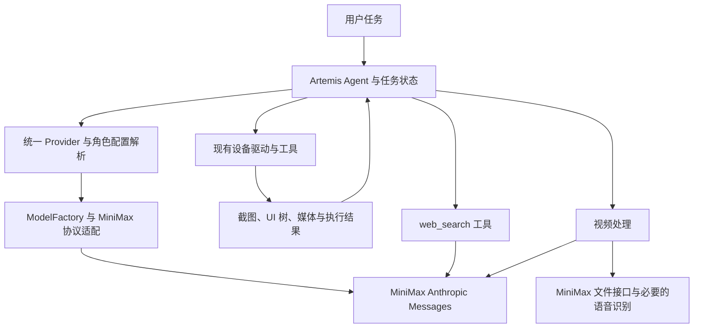
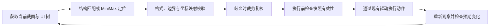

# Artemis 全 MiniMax 技术方案

- 日期：2026-11-01（Asia/Shanghai）。
- 版本：1.2，本次代码实现、独立复核与本地离线验证完成；真实账号能力、定位精度及设备/Docker 运行仍未实测。
- 代码基线：`e7cbe5950fba16b7d31c852aa1e92309d7d6405c`，分支 `feat/model-config`。
- 适用范围：主 Agent 推理、视频分析、Explorer 屏幕探索、联网检索、OCR、目标坐标定位。
- 依据：本次会话已确认的需求、基线代码、MiniMax 官方文档及官方文档 MCP。

## 1. 目标、决策与范围

所有 AI 推理和识别由 MiniMax 提供。文本与视觉推理采用官方推荐的 Anthropic Messages 协议；可选音轨转写使用同一任务凭据调用 MiniMax 原生 ASR 接口，见第 6.2 节。本地保留 Artemis 的任务编排、设备驱动、ADB、截图、UI 树读取、图像裁剪、视频处理、坐标换算和执行结果检查。这些确定性程序不是另一套 AI 模型。

已由用户确定的方向：

1. 使用 MiniMax 完成六个模块的 AI 工作，不依赖 Google/Gemini API Key。
2. 使用 Anthropic 兼容接口；MiniMax 官方文档 MCP 用于开发查阅。
3. 不引入本地定位模型、第三方视觉模型或独立 OCR 模型。
4. 新的模型坐标协议采用 `[x,y]`，不沿用项目当前 `[y,x]` 输出再交换的约定。

本文提出的工程设计：复用现有 Provider 注册表、模型工厂、LangChain/LangGraph 编排与工具；默认候选为 `MiniMax-M3.1-Flash`；各角色通过提示词、思考深度、超时和媒体输入配置区分。模型可用性与实际定位、OCR 效果需要接入后验证，不能由文档能力声明推导为成功率保证。[S1][S2]

用户已批准按本文实施代码，进度和验证证据记录在第 14 节及实施检查点。不在本轮范围内：真实手机自动化测试、购买服务、部署本地模型、生成视频或替换 Android 设备层。视频模块处理的是视频理解，不是调用 Hailuo/H3 生成视频。

本次迁移的硬边界是“不需要 Google Key、不向 Google 模型/媒体/OCR 服务发请求”。保留已经安装的 Google SDK 以兼容原厂商不违反此目标；移除这些依赖和实现完全无 Google SDK 的发行包属于可选后续工作，不作为六模块迁移的前置条件。

## 2. 当前代码与差距

本节记录实施前基线的问题和调研依据，保留作修改范围索引；当前实现及验证状态见第 14 节 Changelog 与实施验收表。

| 位置 | 已观察到的行为 | 目标改动 |
| --- | --- | --- |
| [providers.py](../../artemis/llm/providers.py) | 自定义 `kind` 只允许 OpenAI 兼容协议；默认 Provider 可替换需 Key 的内置厂商 | 增加 `anthropic` 协议，保留现有 OpenAI 条目与默认解析语义 |
| [router.py](../../artemis/llm/router.py) | 已有 `ChatAnthropic` 分支，但没有传入 `endpoint.api_base`；思考深度被映射为 `budget_tokens` | 正确传递 MiniMax 地址，按官方 `output_config.effort` 配置，保留其他厂商原有逻辑 |
| [services/llm.py](../../artemis/services/llm.py) | 主运行路径部分重复 Provider/模型解析；非 Google 模型移除 `google_search` | 统一调用 `resolve_model_config()`；增加真正可执行的 MiniMax 搜索工具 |
| [Explorer](../../artemis/agents/explorer/explorer.py)、[视频分析](../../artemis/agents/video_analyzer/video_analyzer.py) | 原生引擎选择依赖原始 Gemini 模型名、Google Key 或共享 Google Client | 根据已解析的实际 Provider 选择路径，MiniMax 路径不创建 Google Client |
| [目标检测](../../artemis/agents/object_detector/object_detector.py) | 模型按 `[y,x]` 输出，程序交换为 `[x,y]` | MiniMax 提示词、结构化结果与后续消费统一按 `[x,y]` |
| [目标检测模型获取](../../artemis/agents/object_detector/object_detector.py) | `get_llm(ctx, name="object_detector")` 未指定工具模型范围，异常后改用 Operator | 显式按 utility 范围获取已配置的目标检测模型；配置错误不得被宽泛异常捕获掩盖 |
| [ocr_api.py](../../artemis/utils/ocr_api.py) | 直接请求 Google Vision API，使用独立 OCR Key | 替换为 MiniMax 视觉识别；配置就绪条件来自 MiniMax |
| [SDK 预热](../../artemis/sdk/agent.py)、[记忆压缩](../../artemis/memory/chunking.py)、[轻量检查默认值](../../artemis/config/llm.py) | 仍存在 Google 专用初始化或硬编码模型 | 纳入同一 Provider 配置链，覆盖六模块之外的辅助推理入口 |
| [基础 LLM 配置](../../third_party/mobile_use/config/llm.py) | `reasoning_effort` 仅有 none/low/medium/high，fallback 必填 | 支持 MiniMax 所需档位并按厂商校验；迁移期处理必填 fallback，避免重复请求 |

锁文件基线包含 `anthropic==0.122.0`、`langchain-anthropic==1.5.6`、`langchain-core==1.5.6`；实施阶段已在隔离源码环境复用同版本做真实 SDK/模拟 HTTP 验证。发行安装及实际账号权限分别记录，不由锁文件或离线请求通过推导。

### 2.1 调用链复核发现的范围遗漏

以下是方案 1.1 对 1.0 范围的补充，记录当时静态阅读确认的分支或契约；修复进展以 Changelog 为准。

| 编号 | 代码证据与遗漏 | 必须覆盖的改动 |
| --- | --- | --- |
| R01 | [CLI Provider](../../artemis/interfaces/cli/commands/providers.py) 与 [HTTP Provider](../../apps/admin_console/routers/system.py) 测试 Key 固定传 `provider="openai"`；[首页](../../apps/showcase_ui/src/app/pages/home/home.component.ts) 保存固定 `kind="openai"`，测试请求不带协议 | UI→HTTP→验证器、CLI→验证器全链传递协议、厂商和地址；不能只增加 kind 枚举 |
| R02 | [验证器](../../artemis/utils/credentials_validator.py) 的 Anthropic 校验忽略自定义地址；未知厂商仅按 Key 长度可返回成功；[模型目录](../../artemis/llm/providers.py) 通用拼接 `/models` | 按协议实现经过核实的目录路径、鉴权头与地址；不支持的查询明确返回 unsupported，不能退回其他厂商或把格式检查叫作鉴权通过 |
| R03 | [初始化向导](../../artemis/interfaces/cli/commands/init.py) 默认 Gemini，选择其他厂商仍写 `ARTEMIS_DEFAULT_MODEL=gemini-2.5-flash`，且整体覆盖 `.env`；[Settings](../../artemis/config/settings.py) 没有 MiniMax 字段 | 增加 MiniMax 初始化与注册表保存，保留现有设备/其他变量；按 4.3 明确变量用途、来源和生效边界 |
| R04 | OCR 除工具与 Explorer 外，还被 [主感知](../../artemis/graph/perception.py) 和 [Checker 最终截图](../../artemis/agents/checker/checker.py) 调用；[融合函数](../../artemis/utils/ocr_xml_fusion.py) 消费像素多边形，并给裁剪结果加状态栏偏移 | 新 OCR 结果不能直接替换旧返回值；统一转换、偏移只加一次，并覆盖自动调用、任务上下文和降级分支 |
| R05 | [凭据探针](../../artemis/core/diagnostics/probes/credentials_probe.py) 把 `key/raw_key/current_key/api_keys` 放入 metadata；[readiness 路由](../../apps/admin_console/routers/system.py) 返回探针报告；[前端服务](../../apps/showcase_ui/src/app/services/system.service.ts) 读取原始 Key | 修复已有诊断响应泄漏路径，不能照搬到 MiniMax；检查缓存、设备选择响应及其他嵌套报告，前端改为只用配置状态/掩码 |
| R06 | 同一凭据探针的 OCR 判断仍要求独立 `OCR_API_KEY`，说明固定 Google Vision | MiniMax OCR 的 readiness、doctor、前端状态与工具可用性使用同一配置判定；区分已配置、已验证与功能禁用 |
| R07 | [日志分析提示词](../../artemis/agents/log_analyzer/log_analyzer.md) 要求 `google_search`；日志分析、[诊断 Agent](../../artemis/agents/diagnoser/diagnoser.py) 和委员会工具存在 Google 搜索专用过滤 | 角色提示词、工具注册、工具允许列表、执行器和 `enable_grounding` 语义一起接入 `web_search`，不能只新增服务函数 |
| R08 | [可靠性包装](../../artemis/services/llm.py) 的端点标识只有 `provider:model`；相同协议/模型但不同地址会共享熔断、非流式回退等状态 | 端点身份包含注册条目、厂商、地址、模型及非秘密配置版本；MiniMax 与其他 Anthropic 服务隔离 |
| R09 | [会话模型服务](../../apps/admin_console/services/model_service.py) 缓存原始 Operator 配置并有 Gemini 默认值，会话/任务路由依赖它 | 新任务使用统一解析后的实际模型快照，历史任务保持原实际模型；更新配置后不继续显示旧缓存 |
| R10 | [实时回放](../../apps/admin_console/replay_manager.py) 无条件导入并 patch Google `AsyncModels.generate_content` | MiniMax 回放使用现有统一 trace/模型调用入口，不创建/调用 Google Client、不依赖 Google 专用 patch，保留 SDK 兼容 |
| R11 | [容器管理](../../playground/backend_manager/app/services/docker_service.py) 与 [Compose](../../playground/artemis_container/docker-compose.yml) 只转发旧厂商环境变量，没有挂载宿主 Provider 注册表 | 明确容器的应用目录、角色配置和选定 Provider 的秘密注入；宿主机保存成功不代表容器已经可用 |
| R12 | [打包流程](../../setup.py) 复制配置与 UI 构建产物，源码启动和 wheel/容器读取位置不同 | 验证已安装包、非仓库工作目录和容器入口；重新生成 UI 构建产物，不手改带哈希的压缩 JS |

复核也确认两处已有行为可复用：Flash 运行器已将完整响应追加到消息历史；ModelFactory 的模型缓存键已包含地址和 Key 摘要。不能把展示用文字提取误判为所有消息被截断，也无需重复建设客户端缓存；R08 针对的是可靠性状态的端点标识。

### 2.2 v1.2 深度复核：必须补齐的契约

本轮审查对象为文档修订前的 `0280dde` 及其未改变的实现基线。下面记录旧代码在 MiniMax 迁移中必须处理的问题；P1 表示会阻断配置/调用或违背动作执行要求，P2 表示分支正确性或可观测性缺口。它们不是本轮文档修改已经修复的运行时缺陷。

| 编号 / 优先级 | 证据与后果 | 本次必须纳入的修改 |
| --- | --- | --- |
| R13 / P1 | [Provider 类型](../../artemis/config/constants.py) 固定 Literal，[LLM schema](../../third_party/mobile_use/config/llm.py) 用它校验；`minimax` 和自定义别名在 resolver 前即被拒绝。resolved/endpoint 也未携带 vendor | 内置名与受约束注册名均可进入统一解析；厂商贯穿注册表、任务快照、端点、工厂和缓存；未知名字不得预检通过 |
| R14 / P1 | [配置展开](../../artemis/config/llm.py) 丢掉四个可选角色；[MCP profile 选择](../../mcp_server/background/task_runner.py) 优先旧 override 文件，而 profile 合并不展开 default/nodes，失败可恢复默认 | 主配置与 SDK/MCP profile 共用规范化/校验；覆盖可选角色和辅助摘要模型；显式无效配置报错，不静默丢键或恢复另一模型 |
| R15 / P1 | LLM schema 未定义 max_tokens，输入可被静默忽略；[_resolve_endpoint](../../artemis/services/llm.py) 未传预算，[Anthropic 工厂](../../artemis/llm/router.py) 也未使用 endpoint.max_tokens | 输出上限与角色超时形成配置→合并→端点→SDK 的可验证链；参数必须实际进入请求，不能仅在文档中声明预算 |
| R16 / P1 | [with_structured_output 包装](../../artemis/services/llm.py) 在可靠性层前已返回 parsed-only；[Planner](../../artemis/agents/planner/planner.py)、[Checker](../../artemis/agents/checker/checker.py)、[Outputter](../../artemis/agents/outputter/outputter.py) 使用该分支 | 首版 MiniMax 使用保留 raw 的 JSON/Pydantic 路径，先检查终止状态再消费结果；不能丢失 thinking、stop_reason、usage 或靠关闭 thinking 修复解析 |
| R17 / P1 | [像素验证](../../artemis/agents/validator/precondition_pixel.py) 缺字段、低置信否定和异常可放行；[Pro burst](../../artemis/agents/validator/execution_loop.py) 跳过检查，[Flash](../../artemis/agents/flash/runner.py)/[MCP 动作](../../artemis/mcp/action_executor.py) 走其他执行路径；候选适配会丢来源 | 模型定位动作经过同一有效性门禁；候选元数据传到执行边界；不确定不得变通过；屏幕变化后停止旧快照的剩余动作 |
| R18 / P1 | Pro 执行循环捕获所有设备异常后可再执行一次；命令已生效但响应丢失时可能重复点击 | 设备结果区分确定未执行、已派发和结果未知；只有确定未执行可重发，未知结果先观察，不重放副作用 |
| R19 / P2 | [公共坐标](../../artemis/utils/coordinates.py) 使用 round/width−1，[Explorer geometry](../../artemis/agents/explorer/geometry.py) 使用截断/width，[Operator](../../artemis/agents/operator/operator.py) 又有独立转换 | 收敛点的换算与有限数校验；bbox 边缘单列；截图尺寸缺失不使用猜测尺寸执行定位动作 |
| R20 / P1 | [DataEngine](../../artemis/data_engine/engine.py) 只按截图 hash 命中既有 OCR，[Explorer](../../artemis/agents/explorer/run_setup.py) 直接信任；[感知](../../artemis/graph/perception.py) 还会保存失败产生的空列表 | 持久 OCR 缓存加入来源、版本、状态与坐标空间；旧无来源结果不命中新 MiniMax 请求，失败不持久化为已确认 empty |
| R21 / P1/P2 | [视频 universal 循环](../../artemis/agents/video_analyzer/universal_engine.py) 耗尽仍可 success，子工具错误转字符串，音频失败可静默删除；[模式选择](../../artemis/agents/video_analyzer/video_analyzer.py) 对非 Gemini 无条件 static | 明确视频完成状态、必需分段/音频、processing 模式与媒体生命周期；关键帧复用不等于可直接继承旧成功判定 |
| R22 / P1 | [MCP 鉴权验证](../../mcp_server/tools/diagnose.py) 读取 probe 中的原始 Key；注册默认 Provider 元数据没有这些验证目标，删除秘密字段后也会直接返回空列表 | 脱敏与内部验证同时修改：验证从统一 resolver/注册表取得受控凭据，不依赖公开诊断 metadata；空列表不得冒充已验证 |
| R23 / P1/P2 | [可靠性分类](../../artemis/llm/reliability.py) 主要看 HTTP/异常文字，原生 Files 另有业务状态；原生适配如直接放 usage，现有 [meter](../../artemis/services/token_meter.py) 不一定识别 | 薄适配负责业务错误与 usage 规范化，复用既有恢复/计量；永久业务错误不重试成临时故障，不重复计入 thinking |

方案复核时的隔离复现：提取真实类型和函数后，不导入应用、不读取凭据，验证了注册别名校验失败、max_tokens 被丢弃、可选角色被丢弃，以及默认注册表/已脱敏探针的 MCP 验证返回空列表。协议审查还按锁文件 URL 与 SHA256 核对了 `langchain-anthropic==1.5.6` wheel 源码：支持 base_url/output_config 和搜索内容块，默认结构化输出不保留 raw。当时未安装依赖或调用真实模型；后续实施验证另见 Changelog。上述基线事实支持复用 SDK 并补契约的方案选择。

## 3. 方案选择与架构

| 方案 | 取舍 | 决策 |
| --- | --- | --- |
| 保留 Chat Completions，再单独使用 Responses 搜索 | 现有代码改动较少，但消息、思考、搜索存在两套协议 | 不采用 |
| 统一 Anthropic Messages，复用现有编排与工具 | 与官方推荐一致，统一多模态与内容块处理；需要补齐适配 | 采用 |
| 直接重写全部 Agent 为原生 SDK 循环 | 控制自由，但会重复现有编排、可靠性和记录逻辑 | 不采用 |



职责边界：

- `resolve_model_config()` 是运行时与控制台共同的解析所有者，不在各 Agent 中重新解析 Key、模型或默认规则。
- `ModelFactory` 创建模型；MiniMax 专有的参数和内容块适配集中在该层下的薄适配器，不散落到六个模块。
- 各模块只准备任务输入、消费类型化结果，复用现有重试、取消、trace 和任务状态。
- LangChain 保留为编排接口。先验证锁定版本对 MiniMax thinking、视频和服务端工具块的保真；不满足时在薄适配器内使用官方 `anthropic.AsyncAnthropic`，而不是重写上层循环。
- 文档 MCP 是开发辅助工具，不加入 Artemis 的生产执行链，也不承担运行时联网搜索。

模型主入口为 `https://api.minimax.cn/anthropic`，SDK 请求路径为 `/v1/messages`，组合后的 HTTP 路径为 `/anthropic/v1/messages`。文件和语音接口使用 MiniMax 对应原生路径，不强行包装成 Messages；这些接口仍属于 MiniMax。[S1][S3][S4]

## 4. 配置、凭据与保存

### 4.1 凭据的唯一来源

沿用 `<用户应用目录>/llm_providers.json` 保存 Provider，MiniMax 预设默认名为 `minimax`，新增允许 `kind="anthropic"`。`name` 是可自定义的注册别名，新增可选 `vendor="minimax"` 表示厂商，`kind` 只表示传输协议。旧条目未提供 vendor 时维持原通用逻辑；不能仅按别名、模型名前缀或 URL 子串推断厂商。MiniMax 专用思考参数、搜索和媒体能力按 vendor 分支，其他 Anthropic 服务保留原参数映射。

Provider 存储字段继续使用既有格式：`name`、`kind`、`api_base`、`api_key`、`model`、`fallback_model`、`timeout_seconds`、`enabled` 等；新增 vendor，不为了本次接入重命名历史字段。Windows 默认目录为 `%LOCALAPPDATA%\Artemis`，仍遵守 `ARTEMIS_APP_DIR` 覆盖规则。

- Key 只在用户目录保存，禁止写入项目配置、文档、测试夹具或 Git。
- 当前存储格式是明文 JSON；`SecretStr` 和响应掩码不构成磁盘加密。继续使用本机权限保护，检查 Windows ACL，临时文件也必须受保护。
- API 返回 `key_configured` 和掩码，不返回 Key；日志禁止记录授权头。
- 更新时 Key 留空表示保留已有值。首次创建缺 Key 则失败；清除 Key 使用明确操作，不能与“留空保留”混用。
- 保存采用进程间锁、唯一临时文件和原子替换，避免 CLI/API 并发读改写覆盖。写盘失败必须返回错误；持久化成功后才更新生效状态。
- 本方案使用注册表中的 Key，不依赖把 MiniMax Key 写成全局 `ANTHROPIC_API_KEY`，避免影响其他客户端。

注册名必须穿过 LLM 配置类型校验：用受约束字符串支持内置名与注册名，不能只向 Literal 增加一个 `minimax` 而继续拒绝 `minimax-prod`。统一解析后携带 vendor、kind、注册名、地址、模型与非秘密配置版本到 ModelEndpoint；工厂与客户端缓存都按这些影响请求的字段区分。未知/缺失/禁用注册名在新任务启动前失败，不能被当成无需凭据的内置服务。

### 4.2 角色配置

`artemis.jsonc` 继续保存角色与参数；以下是需要适配完成后的目标示例，不是当前即可使用的配置。

```jsonc
{
  "default": {
    "provider": "minimax",
    "model": "MiniMax-M3.1-Flash",
    "reasoning_effort": "medium",
    "fallback": {
      "provider": "minimax",
      "model": "MiniMax-M3.1-Flash",
      "reasoning_effort": "medium"
    }
  },
  "nodes": {
    "planner": { "reasoning_effort": "high" },
    "operator": { "reasoning_effort": "medium" },
    "checker": { "reasoning_effort": "high" },
    "explorer": { "reasoning_effort": "medium" },
    "object_detector": { "reasoning_effort": "low" },
    "video_analyzer": { "reasoning_effort": "medium" },
    "summarizer": { "reasoning_effort": "low" }
  }
}
```

示例保留相同主备模型是为了兼容基线必填 fallback；解析后若主备端点与模型相同，可靠性层必须合并为同一请求重试预算，不再执行第二轮“模型降级”。首版不自动退回 Google 或其他厂商；如以后增加 MiniMax 备用模型，先验证其多模态与工具能力。

`reasoning_effort` 按“厂商＋模型”校验：M3.1-Flash 的 low/medium/high/xhigh/max 映射到 `output_config.effort`，拒绝 none，保留强制 thinking；M3 的 thinking 默认关闭，可配置 adaptive/disabled，不假定支持 Flash 的 effort。未核实的其他模型不因 vendor 相同就继承这些能力。不把 effort 换算为 token budget，不把被官方忽略的 temperature/top_p 显示为有效调优项。[S1]

在角色 schema 中明确加入 `max_tokens` 和 `timeout_seconds`，输出上限为正整数、超时为有限正数；兼容历史 timeout 别名时明确冲突报错。max_tokens 优先级为角色覆盖→全局 default 显式预算→厂商/模型初值；timeout_seconds 为角色覆盖→全局 default 显式值→注册表已有默认→厂商/模型初值，不新增第二份注册表 token 预算。不得用布尔 or 吞掉非法零值或静默丢弃额外参数。主备分别合并，最终 SDK 请求必须携带已解析预算。媒体输入与输出上限分别检查，不能把 max_tokens 当输入容量。

OCR 和搜索是现有工具的新后端，不虚构不存在的 `nodes.ocr` 或 `nodes.search`。两者默认继承已解析的全局 MiniMax 配置；如需要独立开关，扩展现有类型化 Agent 工具配置，通过同一配置加载入口读取，不再增加凭据文件。

### 4.3 环境变量、初始化与配置来源契约

当前代码没有 MiniMax 环境变量接入；仅设置 `MINIMAX_API_KEY` 或更改 `.env` 名称不会自动完成迁移。以下为目标契约：

| 名称 | 用途与优先规则 |
| --- | --- |
| `ARTEMIS_APP_DIR` | 确定用户应用目录及 Provider 注册表位置；CLI、Web、SDK 与容器必须一致，诊断显示实际路径但不显示内容 |
| `ARTEMIS_ARTEMIS_JSONC` | 显式选择角色配置文件，复用现有 `get_config_path()`；显式设置但文件不存在时返回错误，不静默选另一份配置 |
| `MINIMAX_API_KEY` | 新增的可选初始化导入名，仅在用户显式选择“从环境导入 MiniMax”时读取；校验非空/非占位符后写入注册表，不作为每次请求的隐藏 fallback |
| `MINIMAX_BASE_URL` | 与上述导入一起读取，省略时使用本方案官方 Anthropic 基址；映射至既有 `api_base` 字段，不新增第二个持久化地址字段 |
| `ANTHROPIC_API_KEY`、`OPENAI_API_KEY`、`GEMINI_API_KEY`、`GOOGLE_API_KEY`、`GCP_API_KEY`、`OCR_API_KEY`、`VISION_API_KEY` 及原厂商变量 | 保留原兼容用途，选定 MiniMax 后不读取它们作为 MiniMax 的 Key 或 OCR 就绪条件 |
| `ARTEMIS_DEFAULT_MODEL` | 当前声明/初始化写入与实际角色模型解析不构成有效覆盖链；MiniMax 向导不再写 Gemini 值，模型选择保存到注册表及角色配置，不新建第二套默认模型规则 |

运行时 MiniMax 凭据以注册表为准；已有注册表与导入环境值冲突时，未执行明确替换操作就保持原值，不能静默覆盖。环境导入只读进程环境，不自行扫描其他目录的 `.env`；不同启动器的 dotenv 行为不应成为一条额外运行时凭据链。手动表单与 CLI 交互输入直接保存注册表，不回写项目 `.env`。

旧 Settings 的 Google 取值顺序为 GOOGLE→GEMINI→GCP，OCR 为 OCR→VISION；这些是已有别名关系，不是 MiniMax 的别名。容器仅转发 VISION 而 `.env.example` 展示 OCR 的现状也应纳入部署验证，不能搜索替换一个名字就认为全部入口覆盖。

复用角色配置解析入口，并将实际选中的文件路径提供给配置界面和诊断；初始化、运行时和控制台不能各读不同文件。源码 `.env`、用户目录 `.env` 和工作目录 `.env` 当前存在多个加载入口，实施中不得假定修改一个就会全部生效。涉及旧变量的编辑须保留无关条目，避免初始化整文件覆盖。同步 `.env.example`、安装脚本和使用说明，明确环境导入是一次性操作，并且仍需选择角色模型。

### 4.4 主配置、profile 与全 MiniMax 工作配置

复用一个规范化入口处理统一 default/nodes 格式与旧扁平格式。主配置先展开；profile 仅展开其显式给出的覆盖，不凭空填入另一套 Gemini 默认，再按角色深合并并严格验证。已支持角色清单由类型定义与展开器保持一致，包含 history_analyzer、validator_pixel_safety_net、planner_validation、output_analyzer 和 utility 角色。未知角色名/模型参数报错，保留 agent/device 等不属于 LLM 的用户配置。

SDK `AgentProfile(from_file=...)`、MCP 的旧 override 查找与 CLI/Web 使用相同加载规则。显式选中的 profile 缺失或无效即失败；发现旧 override 时显示实际路径与覆盖内容，不能静默优先于用户选择的主配置。现有 presets 目前没有通用运行时选择链，本次不新增一套预设系统或声称写入 presets 即生效；MiniMax 向导写入明确 default/nodes。

迁移须覆盖所选工作配置中的显式模型覆盖，包括 object_detector、hopper 的主备、Flash step_summarizer 和 memory chunking 模型；只修改 default 不够。将旧 thinking_level/thinking_budget 等参数按模型能力清理/转换，而不是把 Google 参数原样发送给 MiniMax。先生成不生效的候选、完整解析全部角色与主备，再发布；写入失败返回失败并按备份恢复本次修改，不声称多文件具备原子事务。

任务启动时对这份 MiniMax 工作配置预解析全部会用到的角色和工具后端，要求实际 vendor 均为 minimax；未满足即不开始任务。其他 legacy 工作配置保留既有“移除默认后恢复内置”的行为，避免改变无关用户。普通编辑/禁用/删除影响后续任务，当前任务保持启动快照；立即停止当前任务继续请求使用现有取消操作。不能把 C01 的新解析禁用检查与 C16 的已启动任务快照混为一谈。

## 5. 消息与调用生命周期

统一生命周期为：解析本任务配置快照 → 组装消息 → 调用 SDK → 完整收集内容块 → 执行本地工具或消费结果 → 回传完整消息 → 继续任务。

1. `thinking`、`text`、`tool_use` 及其他服务返回内容块按原顺序保留；内部对话历史不能只提取文字。前端显示内容与供下一轮回传的原始消息分开。
2. 本地工具按 `tool_use.id` 对应回传 `tool_result`；只执行已注册的本地工具。不能把 `server_tool_use` 当作 ADB 或其他本地工具执行。
3. 流式请求完整收集结束后才提交消息或执行工具，不执行尚未完成的参数片段。
4. `end_turn` 表示本轮结束；`tool_use` 进入本地工具循环；`max_tokens` 表示生成截断，不能把半段 JSON 当成识别结果。`pause_turn` 按服务端续传契约处理。
5. `max_tokens` 包含思考用量。具体预算按角色实测设置；8192 可作初始联调值，不作为所有角色的固定限制。
6. 任务启动后固定 Provider、模型与角色参数。编辑配置影响后续任务，当前任务不在半个工具循环中切换服务；凭据不因版本快照被复制到普通 trace。
7. 客户端关闭、取消和超时沿用现有任务机制，停止后续识别和动作，不在后台继续发起新任务请求。

配置快照必须包含已解析的端点、角色参数与本任务使用的凭据引用/受控内存值，不能只记一个别名后在每次调用重新读注册表。OCR、搜索、预热和辅助推理也接收这个上下文。可靠性状态复用现有存储，但端点标识使用注册条目、vendor、规范化地址、模型及非秘密配置版本；原始 Key 不进入标识或 trace。

完整消息回传、思考参数和多模态输入规则均以官方 Messages 文档为准。工具 schema 由应用验证，不能假设模型输出或 SDK 参数开启后即可保证语义正确。[S1][S2]

### 5.1 结构化输出与原始响应

首版 MiniMax 的 Planner、Checker、Outputter、像素判定及定位/OCR 结构化调用，统一扩展 `acomplete_structured()`：首次请求显式加入 schema 与 JSON 输出约束，先检查原始终止状态及业务错误，再解析/验证/修正。现函数仅解析已有 messages，不会自动注入首次 schema，这部分属于必改。即使截断内容恰好包含可解析 JSON，也不得作为完整判定或动作。只有 thinking、缺必填项、未知终止原因均有明确失败，不从缺失字段推导成功。

保留 OutputConfig 已支持的两类 schema：Pydantic 模型按其类型验证，JSON Schema dict 使用标准验证器验证，不能仅 json.loads；锁文件已有 jsonschema==4.26.0，实施时复用并声明直接依赖，不另写校验器。不支持/无效的 schema 在请求前报错。返回值保持各调用方的 BaseModel/dict 契约。Outputter 的结构化输出失败不能退回未验证字典/原文冒充满足 schema；普通未要求结构化的回答仍可返回文本。

现有 parsed-only `with_structured_output()` 不能直接沿用到 MiniMax；首版不依赖尚未核实的 output_config.format，也不关闭 Flash thinking 来强迫 schema 工具调用。未来采用工具 schema 模式时必须保留 raw，并验证 thinking 下未调用 schema 工具的分支。最多一次格式修正纳入同一个任务预算，原始消息保留在本任务历史，不把展示文本当回传历史。

薄适配器若启用，仍实现现有 ChatModel 的绑定工具、完整响应/流式、回调、取消和关闭契约；原生 `usage` 规范化为现有 AIMessage.usage_metadata 后进入 meter，保留缓存/思考细项且不重复计数。标准 LangChain 路径已做的转换继续复用，不新建 token 账本。

## 6. 六模块实现

### 6.1 主 Agent 推理

保留现有 Planner、Operator、Checker、Summarizer 与 Flash/Pro 的职责，通过统一模型工厂获取 MiniMax。Planner 负责任务计划，Operator 选择动作，Checker 依据实际观察检查结果；同一模型承担不同角色，不取消执行闭环。

所有辅助推理也必须走统一入口，包括 Flash 摘要、记忆压缩、轻量检查、日志分析和输出整理。Google 专用预热替换为实际配置的 MiniMax 初始化；预热不是运行必需的付费推理请求。配置缺失、Key 无效或权限不足时返回可操作错误，不寻找其他环境变量中的厂商 Key。

### 6.2 视频分析

首版复用 [universal_engine.py](../../artemis/agents/video_analyzer/universal_engine.py) 的分段、关键帧与动作窗口加密采样。每帧带原录屏时间戳，结果包含观察时段、事件、证据帧和无法判断的部分。

长片段或时序细节不足时使用同一 Messages 入口的视频内容块，优先本地分段后内联输入。Files 上传并引用 `mm_file://` 作为验证后的可选升级。本地保存分段偏移，不能把片段内时间误作整段录屏时间。原生视频接口与关键帧方法是同一 MiniMax 能力的不同输入策略，不是跨厂商降级。[S1][S4]

需要声音时，单独提取音轨并调用 MiniMax `speech_to_text`，合并带时间戳的转写与画面结果；没有权限时明确说明音频未分析，不能宣称已理解声音。非语音声音识别不由转写功能保证。[S3]

MiniMax 首版 processing=auto 选择关键帧/static；显式 static 支持，显式选择仅 Gemini 支持的 agentic 返回 unsupported，不静默改 static。时序细节不足后的 MiniMax 视频输入仍是本方案自己的输入升级，不冒充 Gemini Interactions 模式。旧 universal 自动附加原始音频并在失败后删除重试的分支改为上述 ASR 流程；将用户要求的音频与可选音频区分。

视频内部结果使用 complete/partial/incomplete/failed，按已分析时段、必需模态和有效最终回答决定状态。循环耗尽不是 complete；子工具错误必须可识别，不能仅返回字符串后报成功。适配现有 `(outcome,status)` 时，只有 complete 可标 success，其余保留明确的未完成/错误事实并同步调用方，不能把 partial 映射为完整成功。

请求范围在协调模型运行前固定：明确秒数如 `from 5s to 12s` 直接绑定；`from 20s to the end` 或 `entire recording` 先由录屏元数据确认结束。无法确认的描述返回 incomplete，不用模型选择的少量子片段反向定义请求。visual 与必需 speech 分别计算成功时段的联合覆盖，ASR 证据不计作画面证据；结果公开 requested_scope 和逐模态 missing_coverage，重叠时段不会重复抵消缺口。

音轨分片同时满足官方 500 秒/50 MB 限制，采用 `response_format=verbose_json`、`stream=false` 获取 segments；普通 json 即使传 timestamp_level 也没有对齐时间。记录片段起点，把 ASR 相对时间和视频时间映射到整段录屏，处理边界重叠；无音轨与转写失败分别记录。[S3]

官方 MiniMax 预设显式关联 Messages 基址与原生 API 基址：Files/ASR 发往 `https://api.minimax.cn/v1/...`，不能把原生路径接在 `/anthropic` 下。自定义网关未配置/核实对应媒体端点时禁用这项能力并报错，不能将其 Key 自动发往另一个官方主机。媒体鉴权沿用该任务选定的受控凭据，不读取全局其他 Key。

上传文件记录任务所有权、内容 hash、用途、端点/账号、file_id 与失效时间；video_understanding 最长保存 7 天，过期不能原样复用。复用本任务仍有效文件以免每次重试重复上传。成功、失败、取消均释放本地临时文件及 SDK/HTTP 资源；仅对本任务创建且无引用、并经验证支持删除的云文件执行清理，外部文件不擅自删除。清理失败单独记录，不能覆盖原异常或假报已清理。[S4][S9]

官方当前删除接口的 purpose 列表未列 video_understanding，主动删除该用途尚不能由文档证明。Files 升级启用前必须验证上传、引用、失效与清理/实际保留行为；未验证时继续使用关键帧或本地分片内联，不承诺视频上传后可立即删除。内联视频、图片、总请求与上传大小按官方各自限制检查，不能只看本地文件大小而漏算 base64 膨胀。[S1][S4][S9]

### 6.3 Explorer 屏幕探索

保留 [universal_runner.py](../../artemis/agents/explorer/universal_runner.py) 的多轮探索循环。先使用已有 UI 树和唯一文字匹配，再请求 MiniMax 解释页面、选择候选或调用定位、OCR、裁剪工具。

原始配置写着 Gemini、环境中残留 Google Key、上下文有旧 Google Client，都不能让已解析的 MiniMax 任务进入原生 Gemini 分支。识别出的候选在同一次屏幕快照内共享，页面变化后失效。

### 6.4 联网检索

新增普通 Agent 工具 `web_search`，复用现有工具注册与执行链；其内部开启独立的 MiniMax Messages 搜索会话，只携带检索问题和服务端搜索工具，避免将整段手机截图历史发送给搜索过程。当前代码没有可以直接沿用的通用 web_search 实现。

请求声明 `type="web_search_20250305"`、`name="web_search"`。适配器消费 `server_tool_use`、`web_search_tool_result` 和最终文字，向主 Agent 返回答案、实际来源 URL、标题及检索状态；不得补造不存在的来源。[S2]

遇到 `pause_turn`，原样回传本轮完整 `content` 后续传。建议首版最多续传 2 次；耗尽返回结构化的部分结果和未完成状态，不能无限循环或将部分结果标为完成。该数值为待实测的可配置初值。

搜索处于官方 Beta，必须与普通模型调用分别探测权限与故障；搜索不可用不伪造答案，也不退回 Google Search。服务端返回的引用与本地工具结果分别记录。

### 6.5 OCR

OCR 直接调用 MiniMax 视觉能力，不再请求 Google Vision，也不安装 RapidOCR/PaddleOCR。输入为截图或裁剪图，要求返回原文和文字边界；不清楚的字符保留无法确定状态，不能根据上下文补字。

OCR 任务使用工具输出或明确 JSON 协议，由 Pydantic 校验。结果封装示例如下；`snapshotId` 和 `imageSize` 由程序赋值，文字和边界来自模型。

```json
{
  "snapshotId": "screen-0001",
  "imageSize": { "width": 1080, "height": 2400 },
  "status": "complete",
  "regions": [
    { "text": "搜索", "bbox": [820, 45, 910, 105] }
  ]
}
```

OCR 状态为 complete/partial/empty；调用异常、输出截断和格式错误属于失败，不转换为空识别结果。文字边界使用第 7 节统一协议。`complete` 仅表示该请求完成，不证明图片中所有文字均已准确识别。

密集文字采用分区裁剪识别，映射回原图后合并重叠结果。复用当前截图识别结果；缓存键至少包括截图内容、裁剪区域、Provider/模型、提示词版本及相关参数。不能单凭应用名缓存，模型自报置信度不用于确定性裁决。

该缓存契约同时覆盖 DataEngine 持久化结果，不仅是内存缓存。复用 ImageRecord.extra_metadata 保存 OCR 来源、模型/配置/提示版本、状态与坐标空间；保留旧历史但无来源/旧 Google 结果不能命中新 MiniMax 识别。失败的 `[]` 不标记为完成的 empty；既有同 hash 记录允许按来源版本更新 OCR。Explorer 读取旧图片记录时同样校验元数据，不能绕过新缓存规则。

旧 `perform_ocr()` 返回 `[{text, position: [{x, y}, ...]}]`，position 是像素顶点；主感知、Checker 和 Explorer 的 XML 融合均依赖它。首版保留新类型化结果，并在调用方进入 XML 融合前使用公共转换函数，将归一化 bbox 转为本次输入图的像素顶点。公共转换函数不加截图裁剪偏移；原有调用方的 `_map_coordinates_back()` 负责状态栏偏移，且只执行一次。全图输入不加偏移；后续分区裁剪先合并到该次 OCR 输入图坐标，再进入此转换，避免两层重复加偏移。新状态与来源信息随结果保留，不丢失失败原因。

旧函数只有图片和可选 HTTP client，没有任务上下文；增加上下文或已解析调用配置，并更新全部调用点。保留可测试的调用注入边界，不沿用 Google HTTP client 作为 MiniMax SDK client。OCR 已配置不等于应在每个感知周期发起付费请求：MiniMax 首版的周期性自动 OCR 默认关闭，显式 OCR 工具和 Explorer 按需识别可用，自动开关纳入类型化配置且不由保存 Key 自动打开。UI 树文字足够时可跳过，对相同截图合并并发识别。旧的宽泛异常降级须记录明确原因；允许继续使用 XML 时标记降级，鉴权失败不能报告成“识别为空”。

将 [is_ocr_configured](../../artemis/utils/ocr_api.py) 的就绪条件改为 MiniMax 视觉配置状态，并更新 Explorer 工具可用性、诊断与前端提示。UI 树直接提供的文字仍可使用，这属于本地结构信息，不是另一个 OCR 后端。

### 6.6 目标坐标定位

复用目标检测工具入口，输入截图、目标描述和必要的上下文，输出 found/ambiguous/not_found。要求定位可操作目标；可点击父元素边界存在时优先使用父元素，而不是机械点击文字区域。

模型给出多个候选且无法区分时，返回 ambiguous；目标不存在时返回 not_found。语法正确的坐标并不证明语义命中，不以“有数字”作为执行许可。

模型结果协议与现有工具外观之间保留明确适配：目标检测入口的 `detected`/`failed`、Explorer 的 `candidates`/`coords`/`bounds` 由适配层转换，禁止把新结构未经转换直接送给旧消费者。有效模型未找到目标仍可返回 failed 查询；配置错误、鉴权错误和 invalid_output 必须沿错误路径传播，不能统一伪装成未找到。

首轮使用全图；小目标或歧义结果使用保留页面上下文的裁剪图进行二次定位，最多执行一次局部复核作为首版预算初值。仍无法确定时停止该动作并交回现有任务恢复流程。不能把同一模型连续调用的相同答案当作独立正确性证明。

## 7. 坐标协议与点击闭环

### 7.1 统一约定

- 点为 `[x,y]`；边界为 `[left,top,right,bottom]`。
- 模型输出是相对“本次实际输入图片”的 0–1000 归一化坐标，左上角为原点，x 向右、y 向下。
- 必须满足 `0 <= left < right <= 1000`、`0 <= top < bottom <= 1000`；非法边界返回无效输出，不交换轴来猜测修复。
- 图像缩放、裁剪偏移和输入图对应的原始截图由程序记录，不能信任模型生成的图片尺寸或快照标识。
- 保留现有内部 0–1000 `[x,y]` 消费接口，在设备执行边界才转为像素。
- 识别边界、中心和变换计算允许有限浮点值；现有 Agent/设备动作工具的坐标数组仍为 0–1000 整数。MiniMax 动作参数不将非法小数截断后执行。按索引操作时由程序选择 bbox 可见范围内最接近中心、且能由整数工具坐标表达的点，并验证它真正派发后的像素位置；没有可表达点时阻断，不验证一个点后执行另一个点。

目标定位结果封装：

```json
{
  "snapshotId": "screen-0001",
  "status": "found",
  "candidates": [
    {
      "label": "搜索按钮",
      "bbox": [820, 45, 910, 105],
      "point": [865, 75],
      "source": "minimax"
    }
  ]
}
```

其中模型提供 status、label 和 bbox；point 首先由程序取合法边界中心作为候选，snapshotId/source 由程序赋值。found 必须只有一个可选候选；ambiguous 至少两个，not_found 为空。数据格式无效使用独立的 invalid_output 错误，不假装目标不存在。

bbox 与文字唯一匹配只构成定位证据，不等于可以点击。结构匹配需用同快照 UI 树确定可操作元素/父级及屏幕可见交集；完整容器中心落在另一个子项、部分出屏或存在覆盖层时不能机械使用中心。缺乏可操作证据时进入局部复核；多个候选无法区分才返回 ambiguous，单候选无法验证则由动作门禁返回 unknown/block，不虚构候选满足数量。当前尚无证据证明非矩形目标中心一定错误，相关精度通过分场景样本验证。

### 7.2 换算与快照有效性

对整图，`xPixel = round(xNorm * width / 1000)`、`yPixel = round(yNorm * height / 1000)`，最终限制在有效像素范围 `[0,width-1]`、`[0,height-1]`。

复用并收敛至公共 coordinates 点转换，统一有限数、合法尺寸和舍入；Explorer/Operator 不再自行截断或夹到 width。bbox 的 right/bottom 是边缘，可到 width/height，使用独立边界转换，不能套点的 width−1 限制。定位执行必须使用实际截图/显示尺寸，缺失时阻断，1080×2400 等展示 fallback 不得用于派发动作。

对裁剪区域 `(offsetX,offsetY,cropWidth,cropHeight)`，先在裁剪图中换算，再加偏移映射到原截图，最后转成现有内部坐标。若存在留白填充或额外缩放，应用完整逆变换；不得直接把裁剪图的归一化点当作整屏点。

示例：1080×2400 截图上的 `[800,200]` 对应像素 `[864,480]`。这是右上方的位置，不执行 `[200,800]` 的轴交换。

每次截图有标识与设备状态版本。截图采集和动作在同一设备任务中串行；本地动作、滚动、旋转、键盘变化使旧候选失效。执行前检查当前版本，并对相关目标区域复核；仅截图哈希相同不能排除所有外部动态变化。目标变化则重新观察，不使用旧坐标。

### 7.3 执行闭环



点击后的页面、控件状态或输入焦点等证据用于判断动作结果。未观察到预期变化时，按有限恢复流程重新判断，不连续重放相同坐标。现有敏感动作确认与设备授权要求继续适用，模型定位结果不绕过它们。

### 7.4 执行入口必须共同满足的条件

定位候选经 Explorer Flash/Pro/Ultra、element index、动作翻译到 Pro Validator、Flash 或 MCP 执行器时，均保留 snapshotId、设备/显示标识、尺寸/旋转、bbox、坐标空间及来源证据。动作有效性由执行边界统一检查，不只修改检测工具的返回 JSON。

MiniMax 任务中 Agent 发起的定位/按索引动作，无论候选来自 XML 结构预匹配、OCR 还是模型，都检查动作与快照有效性，采用严格类型化的 allow/block/unknown 判定；缺字段、低置信否定、模型/鉴权/裁剪异常不可转换为 allow。XML 证据充分时允许本地验证，不强制增加付费视觉调用。unknown 返回可恢复阻断并要求重新观察，不沿用旧像素验证的 fail-open 分支。直接按用户明确坐标执行的独立工具不因此被强制新增付费视觉判断。

实现边界复核：通用 ADB shell 可以直接发送 `input tap`，仅使快照失效不足以满足上述门禁。因此 MiniMax Agent 绑定的两个任意 shell 入口及 `manage_task.send_input` 返回明确 unsupported，UI 操作使用现有受校验动作，日志使用现有读取/检索工具；后台任务查询、结束仍可用。限制放在现有 Agent 工具导出闭包，不接受模型声明的来源参数。 同一约束也覆盖 Explorer 经 [ImageProcessor](../../artemis/agents/image_processor/image_processor.py) 触发的模型生成 Python：现 [PythonExecutor](../../artemis/utils/python_executor.py) 的缩放 AST 检查不构成设备或系统隔离，MiniMax Agent 不开放这项任意代码入口，使用既有固定裁剪、缩放与定位工具；不得用新的脚本黑名单假称已隔离。其他厂商及用户独立命令入口保留原契约。独立脚本执行前使快照失效，其跟踪进程/线程结束后要求重新观察；任意脚本脱离的子进程属于无法仅由宿主进程结束证明的外部动态，不声称可以完全追踪。

Pro burst、Flash 同轮多工具与 MCP 定位动作也必须检查来源有效性。首个改变屏幕的动作执行后，其余旧快照定位动作停止，重新观察/定位后再决定，不继续使用原索引。设备结果区分确定未执行、已派发和结果未知；确认命令可能已生效而响应丢失时，记录 unknown outcome 并观察，不由旧本地重试循环再次点击。“已派发”与“达到任务目标”分别记录。

## 8. 异常、预算与可观测性

| 情况 | 行为 |
| --- | --- |
| 401/403、模型无权限、能力不支持 | 返回明确配置错误；不重试其他厂商，不假报模型就绪 |
| 429、可恢复的网络/服务端错误 | 统一可靠性层有限退避，遵守服务端重试提示，允许取消 |
| 超时发生在模型请求中 | 可重试推理请求但记录可能重复计费；不自动重放已执行的设备动作 |
| 输入媒体过大或格式不兼容 | 在本地分段、裁剪或压缩后按预算重试，保留映射与时间戳 |
| 截断或 schema 不合法 | 记录 invalid_output，最多一次格式修正作为初值；不执行半成品动作 |
| 定位不存在或有歧义 | 返回业务状态，由 Agent 获取更多信息；不冒充网络失败反复重试 |
| 搜索续传耗尽 | 返回部分结果与 incomplete 状态 |

统一统计任务、角色、实际 Provider/模型、耗时、重试、输入输出 token、来源快照、定位与动作结果。尽量复用 DataEngine 与现有 trace；不新建平行遥测系统。原始媒体和对话遵循现有记录权限及生命周期，Key 和授权头不得进入 trace。

重试总预算由一个所有者管理：包括 SDK 自动重试、现有可靠性包装、主备模型和模块格式修正，避免层层倍增。实施时选择一个网络重试所有者并关闭或计入其余自动重试；具体次数通过联调确认。

MiniMax 薄适配同时检查 HTTP、SSE error 和适用原生接口的业务状态，Files 的 HTTP 200 且 base_resp 非成功不算上传成功。余额、Key、模型权限、内容拒绝、参数错误进入永久/需用户处理的失败，频率或服务临时故障进入有限恢复；未知业务码有界失败，不能无限重试。不要推断所有 Messages 错误均用 HTTP 200。保留服务 trace_id 便于定位，禁止原始 Key 进入异常文本。[S7]

统一预算还约束模块内部重试、搜索续传、媒体切片和格式修正的总调用数/截止时间，内部捕获异常不能把永久错误重新包装为可重试普通字符串。取消时终止后续请求并做资源清理；已执行设备动作按 7.4 单独处理，不能套网络重试策略。

## 9. 控制台、CLI 与兼容迁移

复用现有 Provider 表单与 CLI 增加 Anthropic 协议选项和 MiniMax 预设。用户配置入口为服务地址、Key、模型与参数；Key 保留/替换语义在 UI、HTTP 和 CLI 中一致。用户无需维护六份 Key。

就绪检查区分配置存在、存储成功、文本调用、图片、工具调用、搜索和可选音频权限。付费能力检查由用户触发，不能在每次页面刷新时自动生成收费请求；`/models` 成功只说明模型目录查询成功，不能证明定位效果。

迁移规则：

1. 保留原有 Google/OpenAI Provider 数据及其他用户配置。将用户选择的工作配置切换到 `minimax`，主备角色显式同厂商，不批量删除 `.env` 或已有凭据。
2. 保持现有注册表字段和 version 1 格式，新程序同时支持旧 kind 与新增 anthropic。旧程序不保证识别 anthropic；回退前需恢复原 Provider/角色配置备份，不能声称旧程序无损兼容新条目。
3. 修改运行配置前在用户目录保存备份，备份同样含秘密，不进入仓库。回退只恢复本任务修改的配置，不覆盖用户后续无关编辑。
4. Google 原生分支及已安装依赖保留兼容，MiniMax 不创建/预热 Google Client、不调用其服务。公共工具声明不能强迫选择 Google 执行路径；完全移除 Google 包属于可选后续瘦身，本次不以无 SDK 安装验收。
5. 前端新字符串走现有 `t` pipe 与中文词典，不另建页面或国际化系统。

Provider 新建、保存、测试和模型目录查询的 HTTP 请求/响应类型、前端 Service 和 CLI 参数必须一起扩展 kind/vendor，支持自定义注册别名。测试使用当前待保存的地址与协议，禁止固定 OpenAI、忽略自定义地址或遇到未知 vendor 后仅凭 Key 长度判成功。目录查询不支持时允许明确手填模型，不能为获得“测试通过”把秘密发往其他主机。

MiniMax Anthropic 目录使用 `GET /anthropic/v1/models` 与 x-api-key，处理 has_more/last_id 分页，不能沿 OpenAI 规则得到 `/anthropic/models`。目录中的模型仍须按 Messages 接口和本项目所需图片/工具能力筛选，列表出现不等于模型适合全部六模块。[S10]

诊断响应只提供布尔状态、厂商/模型、掩码和非秘密配置来源；移除凭据探针现有原始 Key metadata 及前端回填逻辑，并检查完整嵌套报告与缓存。用户输入的新 Key 仅用于本次提交，保存后清空输入；不通过读取诊断结果恢复 Key。OCR 探针沿用旧 ID 时同步调整说明和判断，改 ID 时必须同步所有消费者。

同步修改 MCP `mobile_diagnose(verify_credentials=true)`：内部验证根据实际解析的注册条目取得凭据、协议、地址与模型，不再读取 probe 的 raw_key/api_keys，也不能只遍历旧内置 Key。公开报告只接收验证结论；未验证/不支持/失败分别表示，空结果不能宣称通过。保留 doctor 已省略秘密、MCP 已递归脱敏的行为，同时替换其修复建议中要求填写 Gemini `.env` 的过时引导。

容器不会自动继承宿主用户目录。部署入口需将选定角色配置与最小 Provider 注册表通过受控秘密文件/挂载提供给容器，在容器内指定一致的 `ARTEMIS_APP_DIR`；校验 UID/权限和路径。不得把 Key 打入镜像、转发全部宿主厂商秘密或只新增环境变量白名单就宣称可用。配置更新后如何重载按任务快照规则处理，现有运行任务不切换凭据。

当前容器部署约定：

- 在根目录构建 `docker build -t artemis-runtime:latest .`，再执行 `docker build -f playground/artemis_container/Dockerfile -t artemis:latest .` 构建 manager 使用的 session 镜像，然后按对应 Compose 启动。两份 Playground Dockerfile 通过 `ARTEMIS_BASE_IMAGE` 复用根 runtime；session 镜像标签须与 manager 的 `ARTEMIS_IMAGE`（默认 `artemis:latest`）一致。根 runtime 包含 ffmpeg、OpenCV 系统库及构建后的 UI/client/core wheel。
- Compose 的 `ARTEMIS_MAIN_CONFIG`、`ARTEMIS_PROVIDER_REGISTRY`、`ARTEMIS_SELECTED_ENV_FILE` 必须是实际源文件的绝对路径。registry-only MiniMax 仍需提供受保护的空 dotenv 文件。单独 session Compose 直接使用这些输入，部署者应提供已裁剪的选中配置/凭据；manager 的源 registry 可以包含多个配置，但对子容器只导出实际选中角色主备及辅助模型所需的条目。
- manager 内 `ARTEMIS_EXPORT_ROOT` 默认 `/var/lib/artemis-session-configs`；必填 `ARTEMIS_EXPORT_HOST_ROOT` 是 Docker daemon 宿主机的绝对目录，并须通过 bind mount 映射到前者。非同机 daemon 也必须满足该映射，不能把 manager 内路径直接当作宿主路径。导出路径必须保持在受控根目录下。
- 子容器设置 `ARTEMIS_ARTEMIS_JSONC=/run/artemis/artemis.jsonc`、`ARTEMIS_APP_DIR=/var/lib/artemis`、`ARTEMIS_CONFIG_READ_ONLY=1`。仅配置、registry 和选中 dotenv 文件只读挂载，日志/数据库等状态可写；HTTP 配置保存和清除返回 403。修改源文件后创建新任务/会话，现有任务不热切换凭据。
- 导出文件权限先保护后写入，正常 stop/启动失败仅清理该 container ID 所拥有的生成文件和空目录。容器移除失败时保留绑定文件；manager 崩溃或外部生命周期留下的导出目录保留为受保护文件，操作员确认无容器使用后自行清理。本次不新增自动 GC/TTL。
- CLI/API/MCP 父入口对新任务作纯配置预检，已接受任务保持幂等返回。队列提交校验提交时配置，SDK worker 启动时固定其实际配置；这不构成跨进程排队期间的秘密配置原子快照。配置改变后应重启已有长期进程。

本机 Docker daemon 不可用，镜像构建/真实容器启动仍待验证；离线测试证明加载、权限、挂载参数与清理归属，不证明 Docker daemon 或实际设备可用。

## 10. 实施范围与阶段

本文规定行为与接口，不代替实施时的逐文件任务计划。预期改动所有者如下。

| 阶段 | 主要现有文件或目录 | 可观察交付 |
| --- | --- | --- |
| A：配置与模型接入 | `artemis/llm/providers.py`、`artemis/llm/router.py`、`artemis/services/llm.py`、`artemis/config/llm.py`、`third_party/mobile_use/config/llm.py` | 新旧配置可加载，MiniMax 地址正确、消息保真，完整工具循环可运行 |
| B：定位与 OCR | `artemis/agents/object_detector/`、`artemis/utils/ocr_api.py`、`artemis/utils/ocr_xml_fusion.py`、`artemis/tools/mobile/ocr.py`、`artemis/agents/explorer/`、`artemis/graph/perception.py`、`artemis/agents/checker/checker.py` | 统一坐标协议、裁剪映射、业务失败状态、全部 OCR 调用与降级分支 |
| C：搜索与视频 | `artemis/services/llm.py`、`artemis/agents/video_analyzer/`、`artemis/tools/`、日志分析/诊断/委员会的提示词与工具注册 | 搜索结果与续传、角色可调用搜索、关键帧和视频理解、可选音轨转写 |
| D：所有入口与配置体验 | SDK、记忆压缩、Flash；Provider HTTP/CLI、凭据验证器、CLI init；Settings/路径/常量与 `.env.example`；诊断探针/报告、会话模型服务、任务/会话路由、回放；前端首页/Service/类型/词典 | 辅助入口没有隐式 Google 请求，变量契约与所有读写入口一致，诊断不泄漏 Key，回放与模型显示正确 |
| E：部署、验证与文档 | `tests/unit/`、受控集成测试、`setup.py` 打包资源、现有安装脚本、Playground 容器管理与 Compose、安装使用文档 | 源码/wheel/容器读取正确配置，程序检查与真实能力评测分开报告，迁移与回退可执行 |

新增文件只在现有模块无法承载明确的协议适配职责时建立；不另造配置注册表、任务循环、工具执行器或重试框架。若更新 vendored 配置，遵循该目录既有修改与来源记录方式。

Google 路径核查除六模块外，还包括 `artemis/constants.py`、`artemis/tools/base.py`、SDK、validator 工具声明和 vendored 模型配置；这些文件中保留兼容类型导入不等于仍在调用 Google 服务。保留旧 Google 协议的 `[y,x]` 测试与适配，MiniMax 增加独立 `[x,y]` 分支；不以全局删交换函数代替协议迁移。Android platform-tools 下载地址、Google 版权文字与 Gemini 模型调用无关，不属于本次替换对象。

复核补充的具体改动所有者：A 包括 constants、LLM schema、SDK profile/override loader 与 MCP task_runner；B 包括公共 coordinates、Explorer geometry/index/候选适配、Validator precondition/execution_loop、Flash/MCP 动作执行与 DataEngine OCR 记录；C 包括视频 processing、结果状态及媒体资源清理；D 包括 MCP diagnose 的内部鉴权验证。属于现有职责补齐，不新建平行框架。

实施顺序按依赖推进：先完成 A 并用离线请求夹具验证配置到 SDK；再打通定位/OCR 的来源与动作门禁，完成离线标注评测；随后接入搜索/视频及全部入口；最后做无 Google Key 的混合残留配置测试和发行物验证。某阶段失败时不把后续未经验证的能力一起宣布可用。

## 11. 验收与验证计划

### 11.1 无 Key、无设备的确定性检查

| 编号 | 必须证明的行为 |
| --- | --- |
| C01 | version 1 的旧 OpenAI 配置仍能读取；新增 anthropic 配置正常；新任务/新配置解析在显式、默认与别名路径都不能使用禁用 Provider |
| C02 | Key 省略时保留；显式清除可区分；写盘失败返回失败；并发更新不丢失；API/日志不泄漏秘密 |
| C03 | 所有角色与控制台复用同一个实际模型解析结果，MiniMax 请求地址不落到 Anthropic 官方服务；object_detector/video_analyzer 正确使用 utility 范围配置，配置错误不静默退回 Operator |
| C04 | thinking、工具 ID、服务端内容块、流式拼接和多轮历史能完整往返；截断不会触发动作 |
| C05 | `[x,y]`、边界合法性、裁剪/缩放逆变换、屏幕边界、旋转和过期快照按协议处理 |
| C06 | found/ambiguous/not_found 与 invalid_output 明确区分，非法坐标和歧义结果不进入点击 |
| C07 | OCR partial/empty/失败不混淆，裁剪结果正确合并，页面变化使缓存失效 |
| C08 | 搜索 pause_turn 能原样续传并受限，server_tool_use 不交给本地工具执行 |
| C09 | 同一主备模型及 SDK/包装层不会倍增重试；超时不重放已完成动作 |
| C10 | 无 Google Key，以及残留 Google Key/原始 Gemini 模型名/共享 Client 的场景中，选择 MiniMax 均只使用批准的 MiniMax 端点；拒绝全部 Google 模型/媒体/OCR 请求的 spy 下六模块及辅助入口可运行，不要求卸载 SDK |
| C11 | UI/HTTP/CLI 的新增、编辑、测试和模型目录查询保留 kind/vendor/base URL；自定义别名仍应用 MiniMax 参数；Claude 分支不受影响；未知厂商不假通过 |
| C12 | 初始化导入变量与注册表冲突按 4.3 处理；无隐藏厂商 Key fallback；缺失显式配置路径报错；初始化保留原 `.env` 无关项 |
| C13 | readiness/doctor/设备选择返回的完整报告、错误与缓存均无原始秘密；前端不依赖 Key 回填；OCR 无独立 Google Key 也能按 MiniMax 配置判就绪 |
| C14 | 主感知、Checker、Explorer、OCR 工具均正确消费新结果，像素多边形和状态栏偏移正确；鉴权失败可识别，自动开关与相同截图并发合并生效 |
| C15 | 日志分析、诊断、委员会等启用搜索的角色能实际调用 web_search，提示词与执行器一致；禁用或无权限时明确返回不可用 |
| C16 | 相同协议/模型但不同地址的熔断与流式降级互不污染；任务进行中修改/禁用注册表不改该任务快照，后续任务使用新配置 |
| C17 | 任务与会话展示实际模型，配置更新不污染历史记录；MiniMax 实时回放不依赖 Google patch，公共入口不触发 Google Client 预热/调用 |
| C18 | wheel 安装后、非仓库 cwd 和容器中均读取预期配置与秘密挂载；UI 包含更新构建产物；仅宿主已配置但容器未注入时明确报错 |
| C19 | 完整配置示例及合法自定义 Provider 别名可实例化；未知/删除/禁用引用启动前失败；vendor/kind 保真到工厂与缓存；legacy 移除默认行为仍可用 |
| C20 | 主配置、SDK from_file、MCP profile 的统一/旧扁平格式等价；四个可选角色不丢失；无效 profile、拼错角色/参数报错，旧 override 不静默抢占 |
| C21 | mock SDK 实际请求中的 max_tokens/timeout 等于角色合并结果，主备独立；零/负/非有限值报错；M3 与 Flash 的 thinking/effort 按模型能力区分 |
| C22 | 首次请求包含 schema，Pydantic/JSON Schema 均真正验证，无效 schema 请求前报错；合法 JSON 无 tool_call 可成功，但截断、仅 thinking、解析失败或缺字段不产生成功判定/动作。未来工具 schema 模式缺对应调用才算失败；各角色先 gate raw 并保留 usage，Outputter 不以未验证结果冒充结构化成功 |
| C23 | 空/错误像素判定、低置信否定、401、裁剪失败、超时均不放行定位动作；Pro 单动作/burst、Flash 多工具、MCP、Explorer 各模式均保留来源并阻断过期目标 |
| C24 | 模拟设备命令已产生副作用后抛超时，断言只派发一次、记录结果未知并观察；确定未执行的失败才允许有界重发 |
| C25 | 点 0/1000、舍入边界、NaN/Infinity、裁剪/旋转、bbox 右下边缘和真实尺寸缺失分别处理；部分出屏/覆盖层/父容器多子项不机械点击中心 |
| C26 | 同截图 hash 的旧 Google OCR、无来源记录、Provider/提示版本切换不命中新 MiniMax 缓存；失败空列表不阻止后续成功识别，历史记录保留 |
| C27 | 视频循环耗尽、子片段失败、空最终回答、必需音频未分析不能完整 success；不支持的显式 processing 报错，auto/static 路径清楚 |
| C28 | ASR 使用带时间 segments 格式并正确叠加切片偏移；文件过期/取消/失败清理、重试复用、媒体大小限制与原生端点鉴权隔离可验证 |
| C29 | MCP 显式验证实际注册 Provider，内部取 Key 不靠公开 metadata；默认条目或脱敏后不会返回空列表冒充已验证，公开输出与错误不泄漏秘密 |
| C30 | Files HTTP 200＋非成功业务码、内容拒绝、余额/权限错误、HTTP 429 与 SSE error 进入正确分类和预算；模块内捕获不重试永久错误 |
| C31 | 若启用原生薄适配，与标准 LangChain 路径对同一录制响应计量一致，缓存/思考字段不重复计数，取消/关闭/工具绑定契约不退化 |
| C32 | 迁移候选覆盖所有显式 Gemini 主备/摘要模型与旧参数，保留无关配置；写盘或验证失败不发布混合配置，新任务预检不能转向剩余其他厂商 |

### 11.2 使用真实 MiniMax 的能力验证

先验证 Key 对文本、图片、工具、搜索、视频与可选语音接口的权限，再进行实际样本评测。不把 HTTP 200、成功解析 JSON 或模型自报置信度当作视觉正确性证明。

建议首批 200 个标注目标，覆盖中文文字、小图标、重复文字、滚动列表、键盘、WebView/自绘界面、目标缺失与动态弹窗。使用已有或获授权的截图离线评测，不自动操作真实手机。

报告必须分开统计：单轮定位点命中目标框的比例、局部复核后的命中比例、错误点击候选、目标不存在/歧义的处理、OCR 文本与边界误差、P50/P95 延迟、token 和调用费用。跨样本类别报告，不能只给平均值或把“选择不点击”计为命中。

当前不编造 95% 等成功率门槛。离线结果提交用户评审后确定业务可接受阈值；未达到时继续优化同一 MiniMax 路线的裁剪、提示词与验证，不静默引入另一家模型。

最后在单个授权模拟器上验证“观察—定位—点击—复核”以及搜索、视频任务；真实手机测试另需明确授权。代码实现后按仓库要求执行窄范围测试、`uv run pytest tests/unit -q`；前端变更执行 `npm run build`。

离线请求验证使用锁定 SDK 和 mock transport/录制响应，检查实际 URL、头、body、内容块、终止状态及重试次数；FakeChatModel 只能证明编排，不能替代协议兼容测试。定位评测必须覆盖最终映射和门禁，不能只统计模型原始坐标。

## 12. 风险、待验证事项与完成状态

- MiniMax 对本项目手机 UI 的细粒度定位、OCR 文字边界精度尚未实测；统一厂商不等于全部任务已有精度保证。
- 当前账号的模型、搜索、文件和语音权限尚未验证；同一个 Key 不等于所有接口都已开通。
- 锁定版 LangChain/SDK 对厂商扩展内容块与视频格式的保真需用录制响应和小规模真实调用验证；若不满足，使用第 3 节薄适配方案。
- 搜索为官方 Beta，输入大小与模型可用性按官方文档和实时错误更新。[S1][S2]
- 官方 Files 删除用途清单尚未列 video_understanding；该可选升级的主动删除与实际账号行为待验证，基本视频分析使用关键帧/本地分片内联不受其阻塞。[S4][S9]
- 本机 RTX 3050 不作为本方案依赖；普通 CPU 执行媒体预处理，模型耗时取决于云端服务与网络。

本次代码开发与本地离线验证已完成，交付在 `feat/model-config`；程序证据见 Changelog 与实施验收表。完整默认测试、前端及安装包检查通过，不构成真实账号权限、200 目标精度或设备/Docker 部署验收；业务阈值仍待实际评测确定。Google SDK 和旧厂商分支保留兼容，MiniMax 任务按固定端点运行；本次不进行依赖瘦身或静默换厂商。

## 13. 官方资料与核对记录

下列资料于 2026-11-01 通过官方文档或官方文档 MCP 核对，属于接口事实依据；本文的模块划分、预算初值和执行策略属于本项目设计。

- [S1：MiniMax Anthropic 兼容接口](https://platform.minimax.cn/docs/api-reference/text-anthropic-api)：地址、模型、内容块、思考参数、多模态与忽略参数。
- [S2：MiniMax 服务端工具](https://platform.minimax.cn/docs/guides/server-tools)：web_search、服务端工具块、pause_turn 与 Beta 状态。
- [S3：MiniMax 语音识别](https://platform.minimax.cn/docs/api-reference/speech-to-text)：音轨转写接口。
- [S4：MiniMax 文件上传](https://platform.minimax.cn/docs/api-reference/file-management-upload)：媒体上传与用途，视频理解需使用对应 purpose。
- [S5：MiniMax 模型调用](https://platform.minimax.cn/docs/guides/text-generation)：官方推荐接入方式与当前模型。
- [S6：官方文档 MCP](https://platform.minimax.cn/docs/mcp)：已注册为 Codex `minimax-docs`，完成 MCP 握手与文档查询。
- [S7：MiniMax 错误码](https://platform.minimax.cn/docs/api-reference/errorcode)：原生业务错误的分类依据，不能只凭 HTTP 200 判成功。
- [S8：Anthropic 消息接口](https://platform.minimax.cn/docs/api-reference/text-chat-anthropic)：Messages 请求与响应接口定义。
- [S9：MiniMax 文件删除](https://platform.minimax.cn/docs/api-reference/file-management-delete)：本任务创建媒体文件的清理接口，具体可删除用途需按接口与实际权限校验。
- [S10：Anthropic 模型目录](https://platform.minimax.cn/docs/api-reference/models/anthropic/list-models)：目录路径、鉴权和分页，不作为多模态能力或账号权限的替代证明。

### 文档自检范围

提交前核对内部链接、示例 JSON/JSONC、坐标示例、必填 fallback 与迁移约束、六模块覆盖、现状/设计/未验证边界和敏感信息。文档没有真实 API Key；接口可用性、视觉精度和程序测试仍按第 11 节执行，不以本次自检替代。

## 14. Changelog

本节记录技术方案的变更与逐阶段实施证据；标明“实施中”的条目仍未完成验收。后续修订本文时须同步更新本节，按版本倒序记录日期、变更内容及验证范围。

### 实施进度：E 旁路、协议与质量收口 — 2026-11-02

- MiniMax 在中央 ImageProcessor、工具适配器和 Explorer 的真实执行入口拒绝自动生成 Python；native/universal 声明及 requires 提示词过滤该工具，历史缓存调用与 Replay 也返回错误，不创建图像、标注、来源或候选。固定 CPU inspect/crop/zoom、目标检测和 OCR 保留；legacy 厂商及用户直接使用低层 PythonExecutor 的行为保持。工具导出避免通用适配器提前获取设备，保留同步/异步及状态注入。
- 真实 SDK 矩阵发现旧 Operator 把 SystemMessage 放在 HumanMessage 后，锁定 Anthropic formatter 会在 HTTP 前拒绝。现将静态执行契约放入初始 system prefix并同步 transcript turn base，仅 MiniMax 的迭代上限提醒使用 HumanMessage。实际默认 Operator 三次请求覆盖 helper、上限提醒和下一轮，active ledger 不混入 SystemMessage；契约文本、预算、终止门禁及 legacy 提醒保持。
- 修正六项 mixin/坐标类型错误；按实际 I/O、解析和模型错误契约收窄异常，保留取消收尾、未知设备结果、插件及凭据脱敏边界。中途一次过度收窄被既有目录异常/秘密 cause 回归抓出并恢复；不修改断言或提高基线。当前 pyright 0 错，ratchet 为 broad 754、silent 0、ignore 16，原基线 754/0/18 保持。
- 质量复核又发现旧 OCR 的 HTTP/JSON 错误及图像池非对象 JSON 会越过收窄后的恢复流程。修复在两个解析所有者中明确类型与对象形状，HTTP 错误只含状态码；保留合法空结果、XML 回退及图像池已成功条目，不扩调用方 catch 或新增框架。原三反例与相关检查关闭，v3 冻结 22 路径、208 项通过，独立规格 43 项及质量 33 项改动检查通过。
- 旧视频测试使用真实微小合成文件，prompt 模拟对无关读取委托原方法，移除全局 Path.stat/exists 覆盖。原 thought_signature、confidence、借入媒体断言保留，增加无关目录和读取正对照；相关检查将线程异常视为错误，不修改 Windows 目录或日志行为。
- 实际 SDK/MockTransport 矩阵补主模型初始化与请求、默认 Operator、Planner、Explorer、定位/OCR、搜索、视频 utility chunk/原生 ASR，以及辅助/历史/Replay 的已有回归。保留 raw Gemini 字符串、残留 Google Key/共享客户端并拒绝 Google 构造及实际 HTTP；这些具名方法检查不等同于真实账号或完整设备任务实测。
- 发行约束固定已验证的 langchain-anthropic 1.5.6 和直接 anthropic 0.122.0，均已核对 MIT；offline lock 的 197 个包版本与来源保持不变。私有 complete-payload hook 的升级必须重验；wheel 清洁安装仍待最终检查。
- 初版 21 路径相关 964 项通过，后续 v3 的 22 路径受影响组 208 项通过，线程异常设为 error。独立初次规格 49 项、最终改动规格 43 项及质量 33 项通过；最终跨模块审查 36 项通过、172 源文件冻结保持，无新可行动发现。完整及发行结果见下；旧失败反例保留，不把源码环境通过当作安装包或模型精度验证。
- root 最终默认 Python 测试 **3427 passed、9 skipped、8 deselected、88 既有普通 warnings，389.76 秒**，将线程异常作为 error，未出现旧视频线程异常；前端完整 **145 SUCCESS**，生产构建 **12.287 秒**。Ruff、674 文件格式、受保护核心 pyright 0 错及 ratchet/公开依赖源检查通过。
- client/core wheel 与 sdist 新鲜构建，从 sdist 单独重建 wheel 成功；归档配置/UI 与本次源文件匹配，无缓存、注册表、`.env` 或 node_modules。初次离线构建因 Cython 缓存不足失败，改用公开 PyPI 获取现有构建依赖成功，运行时 lock 未变，失败日志保留。
- 在仓库外 Python3.12 空环境安装重建 wheel，175 包依赖一致性通过；实际 CLI `--version`、`--help`、MiniMax 初始化和中文路径/受保护注册表/模板不变检查通过。实际 SDK 的 MockTransport 正向请求及超限图片 HTTP 前拒绝通过，源码与安装环境分别验证 langchain-core 1.5.6、1.7.3；Anthropic/LC-Anthropic 固定版本保持。未调用真实模型或设备。
- 测试、构建和安装后 172 个源码/配置/提示词/依赖哈希保持。README/CN 同步 fork 分支克隆、初始化及能力边界；C01–C32 对账保留真实权限、定位精度、设备及 Docker 未验证项。仅交付 feature 分支，不合并或部署 main。

### 实施进度：D3 诊断、父入口与容器 — 2026-11-02

- 候选实现从探针源头移除原始Key，MCP内部鉴权改读canonical私有端点，公开区分配置、鉴权、禁用与未验证。新任务在trace/queue/device前纯预检，MCP父入口和worker复用实际legacy override/explicit主文件选择；已接受的幂等任务保留原返回。
- 容器复用根UI/client/core wheel runtime，按实际选定角色导出受保护的凭据子集及配置文件，只读挂载到可写应用目录。独立legacy Agent/LLM文件的设置和implicit aux语义保留，源文件变更拒绝，私有registry revision避免重读较新Key。
- manager显式区分可见导出目录与Docker宿主路径；配置错误在移除旧容器前失败，只读注入的修改/清除明确403。正常stop/失败清理仅操作当前container ID拥有的导出文件；manager进程崩溃遗留受保护目录保留，不引入自动GC/TTL框架。
- 首轮独立规格审查发现错误类型的Agent配置会将输入反射到公开/缓存诊断及Queue/MCP/container错误，另有legacy custom/ollama/vllm容器丢失选中Key。修复在canonical Agent配置启用验证错误input隐藏，按既有解析规则最小导出选中OPENAI_API_KEY；原5反例、301相关回归及独立18项delta复核通过。旧失败证据保留，未以探针局部掩盖替代其他入口修复。
- 独立质量审查另复现启动请求取消后后台Docker线程晚失败遗留凭据、晚成功遗留容器。现复用既有drain helper，先shield并收尾真实worker，再收尾独立清理任务，重复取消仍保留原异常；移除失败保留绑定文件。原反例不相容的释放顺序及独立释放事件的新反例均保留，67项相关检查及独立规格17项、质量18项通过。
- 最终23路径在完整suite前后保持冻结哈希/范围/Ruff/format/diff，root Python3.12完整单测3343 passed、8 skipped、89 warnings，386.09秒。旧视频fixture全局Path.stat引发的线程警告再次出现，已归E修复，不以exit0忽略。本机Docker daemon不可用，未实际build/start镜像，不把静态挂载/假客户端契约当真实部署验证；E与最终发行验证继续。

### 实施进度：D2 配置入口与初始化迁移 — 2026-11-02

- HTTP、CLI、UI共用完整Provider候选，贯穿协议/vendor/base；原写锁内合并显式字段，空白Key保留、不重放旧凭据，明确确认才能清除。目录测试按OpenAI/Anthropic实际协议请求，缺少MiniMax地址本地拒绝，实际422及传输异常不回显Key。
- `artemis init --provider minimax`迁移全部生效主备/default/nodes/utils/aux，canonical验证未发布候选后写受保护备份。环境导入默认保留已有Key，`--import-env --replace-key`才替换；空/占位值预发布拒绝。解析与source/target比较绑定同一字节revision，保留并发编辑；逐文件原子发布配条件回滚，不冒称多文件原子事务。中文与空格路径经实际dotenv下一次加载验证。
- MiniMax预设、协议编辑、手填ID、公开元数据编辑、Key留空、确认清除与失败重试可用；可明确选择跳过目录验证，显示未验证而非Ready。移除rawKey回填，纠正Key位置/双协议说明及无数据时虚构Gemini；配置获取失败清除旧模型，重试恢复，已知部分字段保持。CLI父入口在设备/daemon前纯预检。
- 19路径v4通过独立规格及质量复核；root完整单测3282 passed/8 skipped/88既有warnings，384.46秒。Angular15例、生产build11.797秒、应用/测试TypeScript检查通过；root哈希/范围/Ruff/format/diff保持，隔离Chrome+假接口检查当前构建。失败历史与已关闭反例详实施记录，不以局部通过替代完整suite。
- README/CN补实际初始化、Key存储、显式导入、保护备份、条件回滚及长期进程配置来源说明。D3诊断/MCP/API父入口/容器和E整链仍待；保留旧通用文件名占位符等UI边界，未宣称全面无障碍、真实账号权限或设备定位精度已验证。

### 实施范围补漏：Explorer 生成 Python 的动作旁路 — 2026-11-02（已在 E 关闭）

- 静态复核确认 Explorer 可经 ImageProcessor 调用 Jupyter PythonExecutor，现 AST 校验仅禁止直接 resize，不能约束设备命令或系统副作用。此前三个 shell 导出入口的限制没有覆盖此路，不能据此宣称所有 MiniMax 动作已受门禁。
- 发现时尚未实施，在第 7.4 节补入相同的任意代码限制；E 已在中央及既有 Agent 入口阻断 MiniMax 自动生成 Python，保留固定 CPU 操作及 legacy/用户直接低层入口。零 coder kernel/模型/设备副作用、错误不升级为候选及实际回放路径经独立复核，证据见本节 E 记录。

### 实施进度：D1 任务配置、辅助模型及历史回放 — 2026-11-02

- 候选实现取消任务profile未知时的Google付费预热，在实际profile选定后、Task发布前复制typed配置并统一预检；保留nested fields_set和live callback身份，执行配置、memory与aux消费任务副本。无设备pure预检接口供后续CLI/MCP/控制台父入口复用。
- 辅助主备在同registry快照中派生，区分implicit旧默认与explicit模型，按M3/Flash重建参数；后台同key去重及终止失败不复活，独立作业预算与内部重试共享。辅助usage只计一次，保留原ledger compaction base。
- 统一显式主配置文件选择、保持独立legacy文件用途；保存非秘密实际模型快照供历史显示，MiniMax回放使用标准trace，Google patch仅有效Google路径。
- 独立审查发现并修复两项配置所有权缺口：generic legacy结果通过context安装对象身份固定；SDK通过实际私有配置对象绑定判断准备状态，公开展示snapshot不能跳过复制或profile选择。v3相关回归446 passed/1 skipped，规格及质量复审各16例通过；root完整单测3220 passed/8 skipped，373.52秒，30源和C44物理哈希保持，Ruff/format/diff通过。旧测试有意义断言原字节保留，既有非空端点snapshot继续是单task上下文的权威，新task创建新上下文。
- 完整测试另有一条旧视频fixture全局Path.stat模拟与日志线程目录创建的时序警告；隔离7例通过，但不据此宣称整套race已消除。E将收窄测试模拟，不屏蔽warning或修改设备行为。D2/D3/E仍待实施；未使用真实Key、模型请求或设备。

### 实施进度：C 视频、语音及回归修复 — 2026-11-01～02

- 实际 universal/Blackboard 入口按任务固定的 MiniMax utility 端点分流，优先于残留 Google Key、raw Gemini 名与共享 Google client。支持 auto/static 关键帧和有界内联视频；显式不支持的 processing 报错，Files 上传未启用。
- 显式记录请求范围、视觉及语音需求、逐模态联合覆盖和缺口。完整、未完成、无音轨、无语音及分析失败分别处理；ASR-only 不计为视觉完成。Pro/pure/Flash、MCP 与诊断消费者正确消费未完成结果，保留原两参数调用。
- native ASR 使用对应官方原生端点、同任务凭据、multipart 大小/时长校验与带时间分段，叠加切片偏移并去除重叠重复；声学事件仍明确不支持。ASR 用量独立记录；整个作业共享有界调用预算，永久业务错误停止重试。
- 厂商专用小子类在锁定 SDK 完整 payload 上校验媒体限额，包含历史内容；schema 字面量不误判为媒体。CPU 顺序解码保留真实 VFR PTS，证据先持久复制；反复取消先等待解码/ffmpeg 释放再清理本任务媒体，借入文件、旧录屏及兄弟文件保留。
- 独立审查关闭请求范围不足、ASR-only 误报视觉、跨录屏缓存、重复取消及可选 ASR 失败事实丢失：UUID/generation 绑定来源，发送前再次核对；SQLite additive media_facts_json 保留程序确认的模态及错误事实，旧历史保留。媒体作者453例、root68例及独立实际入口10/质量14项通过。
- 完整回归另暴露 MCP 冷启动、Windows 文件队列和 Python 3.12 两项问题，按独立片段修复并复核。MCP 只延后 metadata→execution 重依赖，公开SDK包入口保持原内容；执行采用标准 root-before-leaf 导入，KEEP_DEVICE_AWAKE=false 时跳过不必要线程，已使用 runtime 的清理保留。原6秒/4秒/45秒断言均未延长，最终规格13例和质量14例通过。历史冷启动超时仍保留，未声称所有耗时波动已根除。
- 文件队列在未知/暂不可读票据下保持FIFO及容量约束，failed claim 仅清理本请求票；预留 token 使用字面量匹配，拒绝路径分隔符，避免 glob 删除其他任务。相关193例、独立93例及5个实际 Windows IO 场景通过；自然压力202次时既有 replace 失败的非PASS结果保留，未提高重试次数。
- Python 3.12 缓存合并以进入时的报告对象身份判断实际完成顺序，避免粗粒度时钟误合并顺序 force；旧视频测试改用真实借入临时文件，保留全部 confidence/history/thought_signature 断言。相关155例、312/314关键各11例、规格20例及质量312/314各18例通过。
- 媒体、MCP、先前队列与Python3.12修复各自通过独立规格/质量复核。root full8 为3111 passed/8 skipped/2 failed；新反例复现同time_ns随机token错序和未登记截图保存，后继五路径修复相关333例及314关键39例通过。
- 该后继 v1 独立规格复核又发现新 admission FileLock 无界等待绕过 acquire 的 nonblocking/timeout/cancel（真实外部holder复现），因此不通过、不进入质量/完整测试；v2在现owner透传同一总预算和取消条件，获得锁/发布票/获取owner前复核，轮询按剩余预算截断；作者相关125例和314关键46例通过，旧反例/失败证据保留；独立规格v2的7个真实持锁场景、3个正常对照及19代表用例通过，P1关闭；质量复核另发现native释放报错时已发布票残留及原取消异常被覆盖，v3改为公共acquire/release和异常优先的清理，作者相关131例及314关键52例通过；独立规格delta重审12例、7个持锁场景与原质量反例通过，独立质量重审10例及原反例通过，45源哈希与root格式/范围预检通过；root Python3.12完整单测full9最终3161 passed、8 skipped、88既有warnings，388.95秒；suite后45源物理哈希保持、Ruff/format/diff及独立规格/质量复核通过。不是放宽超时或以隔离通过代替完整验收。
- D1辅助模型与任务快照、D2配置入口、D3诊断/容器及E整体CI仍待完成；无真实Key、模型请求、SDK.initialize或设备操作，不以离线通过宣称实际模型精度/账号权限已验证。


### 实施进度：B2 动作闭环 — 2026-11-01

- 接入共享严格目标门禁、实际队列派发前快照检查/失效、单会话并发初始化锁、Pro burst/Flash 同轮版本及 capture 屏障、typed dispatch_state。未知副作用只观察、不重发；显式 unknown 不由错误码改判为未执行。
- 第 7.4 节明确 Agent 通用 shell 的坐标旁路；现有三个导出函数拒绝 MiniMax Agent 任意脚本/终端输入，查询/结束任务及独立用户/legacy 入口保持。不是新执行器、调度器或 shell 解析器。
- 第 7.1 节明确浮点识别/变换与既有整数动作接口的边界；原始动作坐标先验证，bbox 内程序选择可表达点，并检查真正派发像素。保留 B1 新增小数动作 case，收紧为拒绝且零动作；整数、公共数学与 legacy 断言保持。
- 审查修复不确定 OCR 像素升级、越界滑动裁剪、校验点/派发点不同、live XML 身份冲突或目标消失、失败后旧坐标换新来源，以及纯等待后补截图误挡动作。部分 OCR 的确定区域、无 ID 但稳定文字/描述、原无稳定身份的合法视觉验证仍可用。
- 独立规格与质量复核通过：实际 Pro/Flash 原反例、18 个针对性案例及221例定位/视觉回归。ActionResult 固定输出 schema 对12个动作增加 DispatchState/dispatch_state，输入及动作名保持。
- 首次父全量发现的诊断旧注入配置回归已在共用 helper 修复，原诊断源码/测试断言保持；独立定向262 passed。最终 root 全量 **2943 passed、8 skipped、89 上游警告，202.46秒**；21项冻结哈希、20 Python Ruff/format/diff通过。真实 typed/None 配置仍严格预检，opaque 注入不触发解析或模型创建。
- 未使用真实 Key、模型或设备；视频、辅助模型、配置入口及最终发行验证继续实施，不以本阶段测试宣称整体迁移完成。

### 实施进度：B1 定位与 OCR — 2026-11-01

- 已加入 MiniMax utility 定位、严格 xy/LTRB/cardinality、一次局部裁剪复核；OCR 使用全局 MiniMax、分区合并、类型化状态及版本化持久缓存，全部原调用方传任务上下文。
- 截图来源和变换信息贯穿 driver/controller、感知、Explorer 各模式、索引与 Operator；周期自动 OCR 默认关闭，显式 OCR 与按需 Explorer 保留。旧无来源、NULL/坏元数据不冒充可用缓存，模型自报来源不能变为本地可操作证据。
- 公共点转换统一 round/有效像素夹取；有意修正 Explorer 1000 端点越界和 Operator 截断差一像素的历史测试预期，保留无关 legacy 显示约定。
- 独立规格/质量审查发现并修复旧来源同像素洗新、历史融合 OCR 绕缓存、partial 状态丢失、SDK OCR 配置丢失、出屏零面积节点、共享请求取消及状态栏偏移。未知设备 ID 保留 invalid，不伪造身份；observe_screen 固定输出 schema 增加 snapshot/xml_hierarchy/ocr_results/ocr_outcome 及 SnapshotRef，其余工具契约保持。
- 最终 root 全量 unit：2802 passed、8 skipped、89 上游警告，158.23 秒；Ruff、format 和 diff 检查通过。首次全量发现的两项兼容回归已修复，原测试保持。执行前门禁/派发失效属于后续 B2；未调用真实模型或设备。

### 实施进度：A2 协议与搜索 — 2026-11-01

- 根据用户实施授权更新第 1 节范围说明；当前继续执行六模块迁移，真实设备与付费能力验证边界不变。
- 已加入 MiniMax 原始终止状态与工具参数校验、首次 schema 指令及 JSON Schema/Pydantic 验证、共享调用预算、业务错误归类；搜索使用独立 query-only Messages 会话并接入角色工具链。
- 两轮独立审查发现并修复 server_tool_use 参数完整性、真实来源提取、MiniMax 官方 content 结果形状、坏结果误报完成、schema 引用/合法字面量/作用域、半开熔断与并发等待收尾，以及 Outputter 合法 null/空 schema 的处理。实际 SDK 搜索续接保留 content/page_age 和额外字段，普通工具失败传到 ToolMessage.error。
- 最终 root 全量 unit：2713 passed、8 skipped、89 上游警告，165.79 秒；定向审查162 passed、边界复查11 passed，Ruff/diff 通过。未调用真实模型或设备；定位/OCR、执行门禁、视频及入口迁移继续实施。

### 实施进度：A1 基础配置链 — 2026-11-01

- 已实现 Anthropic kind 与显式 MiniMax vendor、合法注册别名、秘密保留/清除语义、进程锁和受保护的原子保存；Windows 临时文件在写入秘密前收紧 DACL，替换后验证权限。
- 主配置/profile 统一规范化，覆盖可选角色、显式路径和旧扁平格式；保留 legacy 轻量检查默认，并修复扁平配置叠加部分 default 的兼容组合。
- 统一实际端点解析及任务快照，MiniMax 预检全部主备、阻止混厂商；legacy 未使用角色缺 Key 不阻断当前角色，快照仍固定凭据。
- 模型工厂显式传 MiniMax 地址、Key、预算和思考参数；SDK 自动重试关闭，应用搜索开关保留供下一阶段接线。目录查询支持 Anthropic 路径、鉴权与有界分页。
- 本阶段定向检查 132 passed；最终全量 unit 2602 passed、8 skipped，ruff/diff 检查通过。结构化响应、搜索、定位/OCR、动作门禁、视频及 UI/CLI/诊断接线仍待后续阶段，未调用真实模型或设备。

### v1.2 — 2026-11-01

- 交叉复核整体设计、配置、协议与视觉执行链，新增 R13–R23；明确问题证据、后果及本次修改所有者，保留原 R01–R12 记录。
- 补齐注册别名类型、vendor 元数据传递、可选角色展开、SDK/MCP profile 规范化、显式配置失败与全 MiniMax 工作配置预检；明确迁移不能只改 default。
- 明确 max_tokens/timeout 配置通道与按模型能力校验参数，修正将 Flash 的 effort/none 行为泛化到所有 MiniMax 模型的描述。
- 首版结构化输出采用保留原始响应的 JSON/Pydantic 路径，兼容 JSON Schema 校验及既有返回类型；首次请求注入 schema，在解析前检查终止/业务状态，补充原生适配器的 usage 与 ChatModel 契约。
- 将不确定阻断、来源保真、过期快照及未知设备执行结果覆盖到 Pro/Flash/MCP；统一点与 bbox 边缘换算，补齐持久 OCR 缓存来源版本。
- 明确视频未完成状态、processing、ASR 时间对齐、原生 API 基址与文件生命周期，记录 video_understanding 主动删除尚未核实；同步诊断脱敏后的内部鉴权验证，补充目录分页和业务错误映射。
- 硬验收收敛为无 Google Key/无 Google 模型服务请求，Google SDK 依赖瘦身降为可选后续；扩展 C19–C32，并区分 SDK 请求夹具与 Fake 模型测试。
- 验证范围：源码/锁定 SDK 源码审查、隔离类型与函数复现、官方接口核对；文档检查覆盖 61 个本地链接、3 个 JSON 示例、R01–R23/C01–C32 编号与 Git 差异格式。未实施运行代码，未验证真实模型精度、账号权限或设备闭环。

### v1.1 — 2026-11-01

- 根据现有调用链复核，补充 R01–R12 共 12 项修改范围遗漏，覆盖 Provider 保存/测试/模型目录、初始化、OCR 调用、诊断、搜索、可靠性、模型显示、回放、容器和打包入口。复核内容提交：`c85d0ff`。
- 明确环境变量命名、初始化导入与注册表优先规则，保留旧 Google/OCR 别名兼容，禁止 MiniMax 隐式回退读取其他厂商 Key。
- 增加独立 vendor 厂商标识，区分 MiniMax 与其他 Anthropic 协议服务的参数适配；补充任务配置快照及可靠性状态的端点隔离要求。
- 补齐 OCR 新旧结果转换、像素多边形、状态栏偏移所有者、自动识别开关、并发合并及失败降级要求。
- 补充诊断报告原始 Key 脱敏、前端回填调整、容器秘密注入和 wheel/UI 构建验证范围；扩展阶段 B–E 的修改清单。
- 确定性验收项由 C01–C10 扩展到 C01–C18；新增本 Changelog。复核修订已检查 36 个本地链接、3 个 JSON 示例及 Git 差异格式；未实施运行代码、真实模型或设备验收。

### v1.0 — 2026-11-01

- 建立全 MiniMax 六模块技术方案，采用 Anthropic Messages 协议，复用现有 Provider、模型工厂、Agent 编排和设备工具。初始方案提交：`85aac5b`。
- 定义凭据保存、角色配置、消息生命周期、视频与搜索接入、OCR、目标定位 `[x,y]` 坐标协议及点击验证闭环。
- 制定迁移/回退、异常与重试预算、分阶段修改范围、C01–C10 确定性验收及真实能力评测计划，记录官方资料和未验证事项；本版本仅交付方案。
